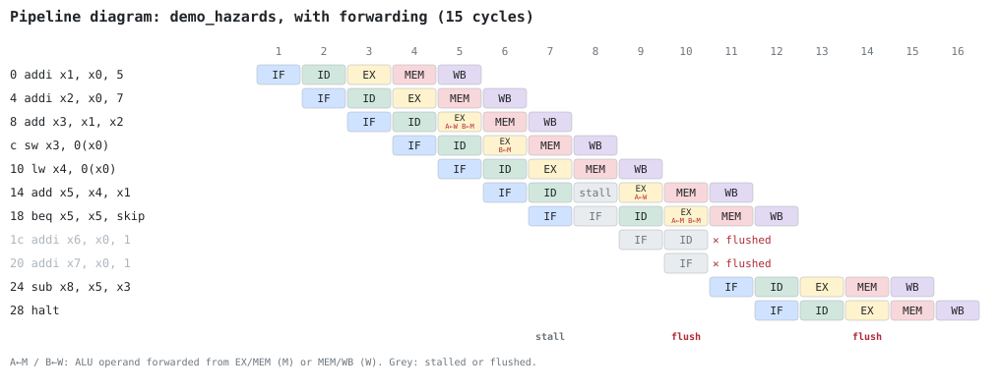
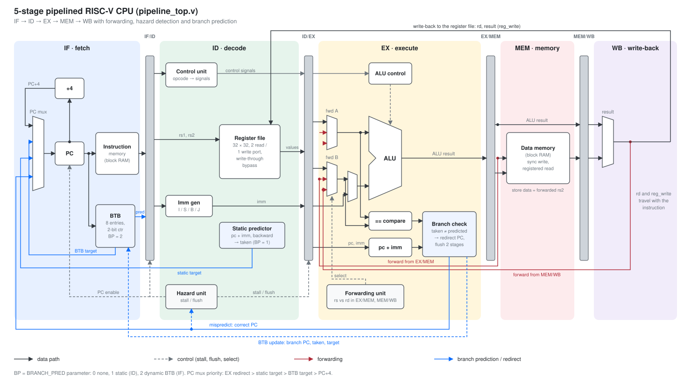
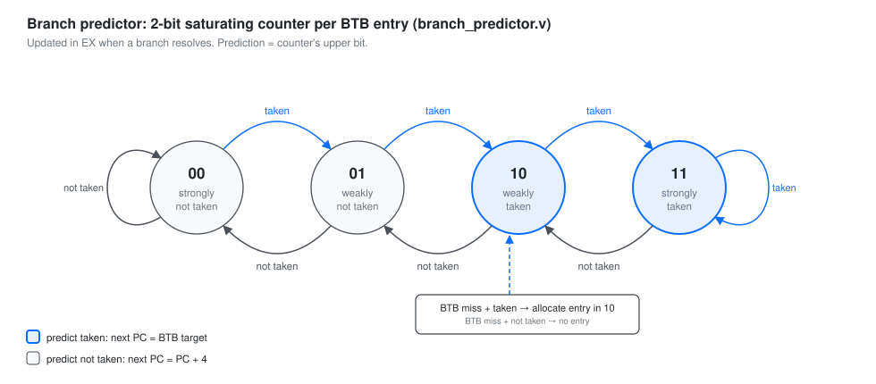

# 5-Stage Pipelined RISC-V Processor

**Project Date:** October 17–23, 2026  
**Architecture:** 5-Stage Pipelined RISC-V (`IF-ID-EX-MEM-WB`)  
**Target Instruction Set:** RV32I Subset

---

## Phase 1 — ALU Implementation

**Date:** October 17, 2026

### 1. What Was Done Today

- Selected the **5-Stage Pipelined RISC-V (`IF-ID-EX-MEM-WB`)** architecture and mapped the target RV32I subset: `ADD`, `SUB`, `AND`, `OR`, `XOR`, `ADDI`, `LW`, `SW`, `BEQ`, `BNE`.
- Analyzed RISC-V instruction formats (`opcode`, `rd`, `rs1`, `rs2`, and split immediates).
- Implemented the 32-bit combinational `ALU_RISCV` module in Verilog.

### 2. Why Start with the ALU?

1. **Zero Dependencies:** It is a pure combinational leaf module requiring no clocks, memory, or pipeline registers.
2. **Core Engine:** Handles arithmetic/logic (`ADD`, `SUB`, `AND`, `OR`, `XOR`), memory address calculation (`LW`/`SW`), and branch comparisons (`BEQ`/`BNE`).
3. **Control Anchor:** Defines the 4-bit control codes that the Control Unit will target.

### 3. How It Works

All arithmetic and bitwise sub-circuits evaluate in parallel as soon as inputs `a` and `b` arrive. The 4-bit `control_alu` signal acts as a multiplexer selector to route the chosen operation to `result_alu`.

#### ALU Control Codes

| `control_alu` | Operation | Expression |
|:---:|---|---|
| `4'b0000` | AND | `a & b` |
| `4'b0001` | OR | `a \| b` |
| `4'b0010` | ADD | `a + b` |
| `4'b0110` | SUB | `a - b` |
| `4'b0100` | XOR | `a ^ b` |

The `zero` flag asserts high (`1'b1`) whenever `result_alu == 0`, providing a direct comparison output for branch instructions (`BEQ`/`BNE`).

---

## Phase 1 — Register File Implementation

**Date:** October 18, 2026

### 1. What Was Done Today

- Designed and implemented the **32×32 Register File (`reg_file.v`)** supporting dual asynchronous read ports and a single synchronous write port.
- Enforced the RISC-V architectural rule that **register `x0` must permanently read as zero** and be immune to accidental overwrites.
- Added write-enable safety checks combined with address protection (`rd != 5'b0`) during clock-edge updates.

### 2. How It Works

#### Asynchronous Reads

`read_data1` and `read_data2` evaluate continuously. If the requested address (`rs1` or `rs2`) is `5'b0`, the hardware bypasses the register array and outputs `32'b0` directly.

#### Synchronous Writes

On the positive edge of the clock (`posedge clk`), if `write_enable` is high and `rd` is not `x0`, `write_data` is stored into `register[rd]`.

### 3. Current RTL (`modules/reg_file.v`)

```verilog
module reg_file (
    input  wire        clk,
    input  wire        write_enable,
    input  wire [4:0]  rs1,
    input  wire [4:0]  rs2,
    input  wire [4:0]  rd,
    input  wire [31:0] write_data,

    output wire [31:0] read_data1,
    output wire [31:0] read_data2
);

    reg [31:0] register [31:0];

    assign read_data1 = (rs1 == 5'b0) ? 32'b0 : register[rs1];
    assign read_data2 = (rs2 == 5'b0) ? 32'b0 : register[rs2];

    always @(posedge clk) begin
        if (write_enable && (rd != 5'b0)) begin
            register[rd] <= write_data;
        end
    end

endmodule
```

---

## Phase 1 — Immediate Generator Implementation

**Date:** October 20, 2026

### 1. What Was Done Today

- Designed and implemented the combinational **Immediate Generator (`imm_gen.v`)** in Verilog.
- Explicitly implemented **only I-type and S-type instruction formats** today (`ADDI`, `LW`, and `SW`).
- Built custom, step-by-step `if-else` sign-extension logic rather than relying on condensed replication shorthand, making the hardware behavior transparent and easy to trace.
- Added a default output assignment (`out = 32'b0`) at the top of the combinational block to prevent unintended latch inference.

### 2. Design Choices & How It Works

#### Explicit Sign-Extension (`if-else` Architecture)

Instead of hiding sign-extension behind nested replication operators, the module explicitly inspects the sign bit (`instruction[31]`):
- **Positive Immediates (`instruction[31] == 0`):** The upper 20 bits are explicitly padded with zeros (`20'b0`) and concatenated with the 12-bit immediate.
- **Negative Immediates (`instruction[31] == 1`):** To preserve two's complement negative values across 32 bits, the upper 20 bits are explicitly padded with ones (`20'hFFFFF`) and concatenated with the 12-bit immediate.

#### Immediate Source Control Codes (`src`)

| `src` | Format | Target Instructions | Immediate Bit Mapping |
|:---:|:---:|---|---|
| `2'b00` | **I-Type** | `ADDI`, `LW` | `instruction[31:20]` (contiguous 12-bit field) |
| `2'b01` | **S-Type** | `SW` | `{instruction[31:25], instruction[11:7]}` (split 7-bit + 5-bit fields) |

*Note: Only I-type and S-type instructions were implemented today. B-type (`2'b10`) for branches will be added in a subsequent session.*

### 3. Initial RTL (`modules/imm_gen.v` — v1)

```verilog
module imm_gen (
    input  wire [31:0] instruction,
    input  wire [1:0]  src,
    output reg  [31:0] out
);

    always @(*) begin 
        // Default output to prevent unwanted latches
        out = 32'b0;

        // I-type instructions (e.g., ADDI, LW)
        if (src == 2'b00) begin 
            if (instruction[31] == 0) begin
                out = {20'b0, instruction};
            end
            else begin 
                out = {20'hFFFFF, instruction};
            end
        end
        
        // S-type instructions (e.g., SW)
        else if (src == 2'b01) begin
            if (instruction[31] == 0) begin
                out = {20'b0, instruction, instruction[11:7]};
            end
            else begin
                out = {20'hFFFFF, instruction, instruction[11:7]};
            end
        end
    end

endmodule
```

---

## Phase 1 — Immediate Generator Refactoring & Full Format Expansion

**Date:** October 21, 2026

### 1. What Was Done Today

- Identified a key structural redundancy while expanding `imm_gen.v` toward B-type (`src == 2'b10`) and J-type (`src == 2'b11`) support: checking `if (instruction[31] == 0)` repeatedly inside every `src` branch was duplicating the exact same sign-bit check across multiple blocks.
- Refactored `imm_gen.v` to evaluate the MSB (`instruction[31]`) **only once** at the top of the combinational block using a dedicated 20-bit intermediate padding register (`reg [19:0] pad`).
- Replaced the nested `if-else` trees inside each instruction format branch with clean, single-line concatenations utilizing `pad` (and sliced subsets `pad[18:0]` and `pad[10:0]`).
- Completed full bit-distribution support for **I-type, S-type, B-type, and J-type** formats and ensured full `else` coverage to prevent latch inference.

### 2. Design Realization & Why It Matters

1. **Architectural Consistency in RISC-V:** Because the RISC-V ISA intentionally places the immediate sign bit at `instruction[31]` across all immediate instruction formats (I, S, B, U, J), the sign-extension decision is completely independent of `src`.
2. **Factoring Out Common Logic:** By decoupling the **sign-bit evaluation** from the **bit-field extraction**, we eliminate repetitive nested `if-else` blocks. `pad` is computed once (`20'b0` for positive, `20'hFFFFF` for negative) and reused across every format below it.
3. **Cleaner Hardware & Scalability:** As more instruction formats are added, we slice the exact number of upper sign-extension bits needed from `pad`, keeping the RTL compact, readable, and aligned with real hardware multiplexing.

### 3. Instruction Formats & Bit Distributions

#### 1. I-Type (`src == 2'b00`) — e.g., `ADDI`, `LW`
- **Bit Distribution:** Contiguous 12-bit field (`instruction[31:20]`) padded with 20 sign bits (`pad`).
- **RTL Implementation:**
```verilog
out = {pad, instruction};
```

#### 2. S-Type (`src == 2'b01`) — e.g., `SW`
- **Bit Distribution:** Split 7-bit upper field (`instruction[31:25]`) and 5-bit lower field (`instruction[11:7]`) padded with 20 sign bits (`pad`).
- **RTL Implementation:**
```verilog
out = {pad, instruction, instruction[11:7]};
```

#### 3. B-Type (`src == 2'b10`) — e.g., `BEQ`, `BNE`
- **Bit Distribution:** 13-bit signed branch offset (`imm[12]` at `[31]`, `imm[11]` at `[7]`, `imm[10:5]` at `[30:25]`, `imm[4:1]` at `[11:8]`, and `imm[0]` hardwired to `1'b0`), padded with 19 sign bits (`pad[18:0]`).
- **RTL Implementation:**
```verilog
out = {pad[18:0], instruction[31], instruction[7], instruction, instruction[11:8], 1'b0};
```

#### 4. J-Type (`src == 2'b11`) — e.g., `JAL`
- **Bit Distribution:** 21-bit signed jump offset (`imm[20]` at `[31]`, `imm[19:12]` at `[19:12]`, `imm[11]` at `[20]`, `imm[10:1]` at `[30:21]`, and `imm[0]` hardwired to `1'b0`), padded with 11 sign bits (`pad[10:0]`).
- **RTL Implementation:**
```verilog
out = {pad[10:0], instruction[31], instruction, instruction[20], instruction, 1'b0};
```

### 4. Current RTL (`modules/imm_gen.v` — Final)

```verilog
module imm_gen (
    input  wire [31:0] instruction,
    input  wire [1:0]  src,
    output reg  [31:0] out
);

    reg [19:0] pad;

    always @(*) begin 
        if (instruction[31] == 1'b0) begin
            pad = 20'b0;
        end
        else begin
            pad = 20'hFFFFF;
        end

        if (src == 2'b00) begin
            out = {pad, instruction};
        end
        else if (src == 2'b01) begin
            out = {pad, instruction, instruction[11:7]};
        end
        else if (src == 2'b10) begin
            out = {pad[18:0], instruction[31], instruction[7], instruction, instruction[11:8], 1'b0};
        end
        else if (src == 2'b11) begin
            out = {pad[10:0], instruction[31], instruction, instruction[20], instruction, 1'b0};
        end
        else begin
            out = 32'b0;
        end
    end

endmodule
```

---

## Phase 1 — ALU Control Unit Implementation

**Date:** October 22, 2026

### 1. What Was Done Today

- Designed and implemented the combinational **ALU Control Unit (`alu_control.v`)** in Verilog.
- Mapped the 2-bit category selector (`alu_op`) alongside `funct3` (`instruction[14:12]`) and `funct7` (`instruction[31:25]`) to drive the 4-bit `control_alu` signal into the ALU.
- Structured the decoding logic using explicit `if-else` trees with a safe default assignment at the top of the combinational block to prevent latch inference.

### 2. How It Works

In a two-level RISC-V control scheme, the Main Control Unit inspects the instruction `opcode` and sends a 2-bit `alu_op` category code to `alu_control`. The ALU Control Unit then resolves the exact 4-bit hardware operation:

| `alu_op` | `funct3` | `funct7[5]` (`instruction[30]`) | Instruction Category / Target | Operation | `control_alu` |
|:---:|:---:|:---:|---|---|:---:|
| `2'b00` | *Any* | *Any* | `LW`, `SW` (Memory Address Offset) | ADD | `4'b0010` |
| `2'b01` | *Any* | *Any* | `BEQ`, `BNE` (Branch Comparison) | SUB | `4'b0110` |
| `2'b10` | `3'b000` | `1'b0` | `ADD` | ADD | `4'b0010` |
| `2'b10` | `3'b000` | `1'b1` | `SUB` | SUB | `4'b0110` |
| `2'b10` | `3'b111` | *Any* | `AND`, `ANDI` | AND | `4'b0000` |
| `2'b10` | `3'b110` | *Any* | `OR`, `ORI` | OR | `4'b0001` |
| `2'b10` | `3'b100` | *Any* | `XOR`, `XORI` | XOR | `4'b0100` |

### 3. Current RTL (`modules/alu_control.v`)

```verilog
module alu_control (
    input  wire [1:0] alu_op,
    input  wire [2:0] funct3,
    input  wire [6:0] funct7,
    output reg  [3:0] control_alu
);

    always @(*) begin
        control_alu = 4'b0010;

        if (alu_op == 2'b00) begin
            control_alu = 4'b0010;
        end
        else if (alu_op == 2'b01) begin
            control_alu = 4'b0110;
        end
        else if (alu_op == 2'b10) begin
            if (funct3 == 3'b000) begin
                if (funct7[5] == 1'b1) begin
                    control_alu = 4'b0110;
                end
                else begin
                    control_alu = 4'b0010;
                end
            end
            else if (funct3 == 3'b111) begin
                control_alu = 4'b0000;
            end
            else if (funct3 == 3'b110) begin
                control_alu = 4'b0001;
            end
            else if (funct3 == 3'b100) begin
                control_alu = 4'b0100;
            end
            else begin
                control_alu = 4'b0010;
            end
        end
        else begin
            control_alu = 4'b0010;
        end
    end

endmodule
```

---

## Phase 1 — Instruction Memory Implementation

**Date:** October 23, 2026

### 1. What Was Done Today

- Designed and implemented the **Instruction Memory (`instr_mem.v`)** module for the Instruction Fetch (`IF`) stage.
- Configured a 64-word (32-bit wide) storage array (`reg [31:0] memory [0:63]`) with continuous asynchronous read access.
- Implemented word-aligned addressing (`read_address[7:2]`) to map byte-addressed Program Counter (`PC`) values directly to 32-bit instruction entries.
- Added an `initial` block utilizing `$readmemh("program.hex", memory)` to preload machine-code test programs during simulation.

### 2. Design Choices & How It Works

#### 1. Asynchronous Combinational Read
During normal operation, Instruction Memory acts as a read-only lookup table. As soon as the Program Counter (`PC`) presents a new `read_address`, the corresponding 32-bit `instruction` word is driven onto the output bus without waiting for a clock edge.

#### 2. Word-Aligned Indexing (`read_address[7:2]`)
Because RISC-V memory is byte-addressed and every RV32I instruction is 4 bytes (32 bits) wide, sequential `PC` addresses increment by 4 (`0x00`, `0x04`, `0x08`, `0x0C`). Rather than wasting space declaring an array of individual bytes, `memory` is structured as an array of 32-bit words:
- **`read_address[1:0]` (Byte Offset):** Discarded, as instructions are aligned on 4-byte boundaries.
- **`read_address[7:2]` (Word Index):** Extracts the 6-bit word index ($2^6 = 64$ words), dividing the byte address by 4 in hardware with zero gate delay.

### 3. Current RTL (`modules/instr_mem.v`)

```verilog
module instr_mem (
    input  wire [31:0] read_address,
    output wire [31:0] instruction
);

    reg [31:0] memory;

    initial begin
        $readmemh("program.hex", memory);
    end

    assign instruction = memory[read_address[7:2]];

endmodule
```

---

## Phase 2 — Verification Infrastructure & Single-Cycle CPU

**Date:** October 23, 2026

### 1. What Was Done Today

- Added self-checking testbenches for every module (`tb/`), run with Icarus Verilog.
- Added `pc.v`, `control_unit.v`, `data_mem.v` and `single_cycle_top.v`, completing the single-cycle reference CPU.
- Added `tools/rvasm.py`: an assembler for our subset plus an ISA-level reference model that produces the expected final register/memory state for every program.
- Added test programs in `programs/` (`alu_basic`, `imm_negative`, `mem_basic`, `branch_basic`, `sum_array`, `fib`). All six pass on the single-cycle CPU.

### 2. Bugs Fixed

| Module | Bug | Fix |
|---|---|---|
| `alu_control.v` | For I-type instructions `funct7` is really `imm[11:5]`, so `addi x1, x0, -1` (bit 30 = 1) decoded as **SUB**. | New `alu_op = 2'b11` for I-type ALU ops: decodes `funct3` only. |
| `reg_file.v` | In the pipeline WB writes and ID reads in the same cycle; ID would read the stale value. | `BYPASS` parameter: when 1, a same-cycle write is forwarded to the read port. The single-cycle CPU uses `BYPASS = 0` (a bypass there would form a combinational loop). |
| `instr_mem.v` | `$readmemh("program.hex")` only worked if the simulator ran from `modules/`. | `MEM_FILE` parameter; testbenches load programs directly. Unused words are NOPs. Size increased to 256 words for benchmarks. |

Registers and data memory now start at zero so simulation never shows `X` values.

### 3. Control Signals (`control_unit.v`)

| Instr | `reg_write` | `imm_src` | `alu_src` | `mem_write` | `result_src` | `branch` | `alu_op` |
|---|:-:|:-:|:-:|:-:|:-:|:-:|:-:|
| R-type | 1 | xx | 0 | 0 | 0 | 0 | 10 |
| ADDI/ANDI/ORI/XORI | 1 | 00 | 1 | 0 | 0 | 0 | 11 |
| LW | 1 | 00 | 1 | 0 | 1 | 0 | 00 |
| SW | 0 | 01 | 1 | 1 | x | 0 | 00 |
| BEQ/BNE | 0 | 10 | 0 | 0 | x | 1 | 01 |

Branch decision: `branch & (funct3 == 000 ? zero : ~zero)`.

### 4. How Verification Works

1. `tools/rvasm.py prog.s build/` writes `prog.hex` and `prog.expected` (32 registers + 256 memory words, computed by the Python reference model).
2. The CPU testbench loads both, runs until the halt instruction (`beq x0, x0, 0`) is fetched, then compares every register and every memory word.
3. The checks were mutation-tested: re-introducing the ADDI→SUB bug makes `imm_negative` fail on 6 registers.

```bash
brew install icarus-verilog   # once
make test                     # all unit tests + all programs on the single-cycle CPU
make clean
```

Waveforms for each program are written to `build/single_<prog>.vcd` (open with GTKWave).

---

## Phase 3 — 5-Stage Pipelined CPU

**Date:** October 23, 2026

### 1. What Was Done Today

- Built the pipelined CPU (`pipeline_top.v`) from the verified single-cycle modules plus four pipeline registers: `if_id.v`, `id_ex.v`, `ex_mem.v`, `mem_wb.v`.
- Added `forwarding_unit.v` (EX/MEM and MEM/WB → ALU operands) and `hazard_unit.v` (load-use stall, branch flush).
- A `FORWARDING` parameter builds the same CPU without forwarding, so its effect on CPI can be measured.
- The pipelined CPU passes every program, checked against the same expected state as the single-cycle CPU, plus 300 random hazard-heavy programs on all three CPUs (900 runs).

### 2. Pipeline Organisation

```
 IF            ID                 EX                       MEM          WB
 PC ─► IMEM ─► |IF/ID| ─► control, ─► |ID/EX| ─► fwd mux ─► ALU ─► |EX/MEM| ─► DMEM ─► |MEM/WB| ─► result mux
                          regfile,                    ▲    branch?                              │
                          imm_gen                     └──── EX/MEM, MEM/WB results ◄────────────┘
```

| Register | Holds |
|---|---|
| `IF/ID` | `valid`, `pc`, `instr`. `enable` (stall) and `flush` (flush wins). |
| `ID/EX` | `valid`, `pc`, `instr`, all control signals, `read_data1/2`, `imm`, `rs1`, `rs2`, `rd`. `flush` inserts a bubble. |
| `EX/MEM` | `valid`, `pc`, `instr`, `reg_write`, `mem_write`, `result_src`, `alu_result`, forwarded store data, `rd`. |
| `MEM/WB` | `valid`, `pc`, `instr`, `reg_write`, `result_src`, `alu_result`, `read_data`, `rd`. |

`valid`, `pc` and `instr` are carried through every stage so waveforms and the trace show which instruction is where.

### 3. Hazard Handling

| Hazard | With forwarding (`FORWARDING=1`) | Without (`FORWARDING=0`) |
|---|---|---|
| ALU result needed by the next instruction | forwarded from EX/MEM, 0 cycles | stall 2 cycles |
| ALU result needed two instructions later | forwarded from MEM/WB, 0 cycles | stall 1 cycle |
| Three instructions later | register file write-through bypass | same |
| Load result needed by the next instruction | **stall 1 cycle**, then MEM/WB forward | stall 2 cycles |
| Taken branch | resolved in EX, predict not-taken: flush IF/ID + ID/EX, **2 cycles** | same |

- `id_uses_rs1` / `id_uses_rs2` stop false stalls on I-type and LW instructions, whose rs2 field is part of the immediate.
- A taken branch overrides a stall, because the stalled instruction is on the wrong path.

### 4. Results (Simulation)

Cycles are counted from the first fetch to the cycle the last instruction leaves WB, so they include the 4 cycles needed to fill the pipeline. N independent instructions take N + 4 cycles. The halt instruction is not counted.

| Program | Instr | Single-cycle CPI | Pipelined, forwarding: cycles / stalls / taken branches / CPI | Pipelined, no forwarding: cycles / stalls / CPI |
|---|--:|:-:|:-:|:-:|
| `alu_basic` | 8 | 1.00 | 12 / 0 / 0 / **1.50** | 14 / 2 / 1.75 |
| `imm_negative` | 12 | 1.00 | 16 / 0 / 0 / **1.33** | 18 / 2 / 1.50 |
| `mem_basic` | 14 | 1.00 | 18 / 0 / 0 / **1.29** | 22 / 4 / 1.57 |
| `branch_basic` | 20 | 1.00 | 36 / 0 / 6 / **1.80** | 48 / 12 / 2.40 |
| `fib` | 89 | 1.00 | 115 / 0 / 11 / **1.29** | 151 / 36 / 1.70 |
| `sum_array` | 88 | 1.00 | 138 / 10 / 18 / **1.57** | 189 / 61 / 2.15 |

Observations:
- With forwarding, the only stalls are load-use stalls (one per `lw` → `add` in `sum_array`). Every other cycle above N + 4 comes from taken branches (2 each).
- Forwarding removes 33–58 % of the extra cycles. For example, `sum_array` drops from 101 extra cycles to 50, and `fib` from 62 to 26.
- Single-cycle CPI is always 1, but its clock period must cover IMEM + regfile + ALU + DMEM + write-back. The pipelined clock only needs the slowest stage. The real comparison is **CPI × clock period**, which needs Fmax from synthesis (still to do).

### 5. Verification

```bash
make test                    # 10 unit tests + 6 programs × {single-cycle, pipelined fwd, pipelined no-fwd}
make random [NRAND=300]      # random hazard-heavy programs on all three CPUs vs the reference model
make trace PROG=sum_array    # cycle-by-cycle pipeline diagram (FWD=0 for no forwarding)
```

- **Unit tests** cover every module, including the forwarding priority rules, every hazard-unit stall/flush case, and pipeline-register stall/flush priority.
- **Random differential testing** (`tools/randprog.py`): 60-instruction programs that write only `x1`–`x7`, so dependencies occur constantly. They include forward branches and loads/stores near a fixed base.
- **Mutation check.** Four typical pipeline bugs were injected one at a time and every one was caught: no load-use stall, wrong forwarding priority, no register-file bypass, store data not forwarded. The forwarding-priority bug was caught **only** by the random tests.
- Bug found while writing the tests: with `ENABLE = 0`, the forwarding unit's `always @(*)` block had no signals to react to, so in simulation it never ran and its outputs stayed `X`. It was rewritten with continuous `assign`s.

Example trace (`make trace PROG=sum_array`), showing a taken branch followed by a load-use stall:

```
cycle      IF     ID     EX    MEM     WB  event
   71 00003c 000038 000034 000030 00002c  branch taken -> flush IF/ID, ID/EX  fwd A=10 B=00
   72 000028     --     -- 000034 000030
   73 00002c 000028     --     -- 000034
   74 000030 00002c 000028     --     --  stall (hazard on ID instruction)
   75 000030 00002c     -- 000028     --
   76 000034 000030 00002c     -- 000028  fwd A=00 B=01
```

Waveforms: `build/pipe_fwd1_<prog>.vcd` and `build/pipe_fwd0_<prog>.vcd` (GTKWave).

---

## Phase 4 — Benchmarks, Waveforms & FPGA Synthesis

**Date:** October 23, 2026

### 1. What Was Done Today

- Wrote 7 benchmark programs (`programs/bench_*.s`), each isolating one effect. `tools/perf.py` (`make perf`) runs every program on all three CPUs and writes `results/perf.md`.
- Generated report figures from simulation (`make figures` → `figures/*.svg`): pipeline diagrams and waveforms. The testbench tracks each fetched instruction through the stages using the CPU's own stall/flush signals, and checks that tracking against the real pipeline registers every cycle.
- Synthesised and placed-and-routed all designs on a Lattice **iCE40 HX8K** with Yosys + nextpnr (`make synth` → `results/synth.md`).
- Timing-driven fix: branches now use a dedicated `==` comparator instead of the ALU's `zero` flag. This raised the pipelined Fmax from 38.6 to 48.8 MHz, with fewer logic cells.
- Added a program-load write port to `instr_mem` (`imem_we/imem_waddr/imem_wdata`, tied to 0 in the testbenches). Without it, Yosys treats the program as a constant ROM and optimises away logic the program never uses, which would make the synthesis numbers meaningless. `IMEM_DEPTH`/`DMEM_DEPTH` are now parameters.

### 2. Benchmarks — Cycles and CPI

| Benchmark | What it isolates | Instr | Pipelined + fwd CPI | No-fwd CPI |
|---|---|--:|--:|--:|
| `bench_independent` | no hazards (ideal) | 121 | **1.033** (= (N+4)/N) | 1.033 |
| `bench_dependent` | every instruction uses the previous result | 61 | **1.066** | 3.033 |
| `bench_loaduse` | each load used immediately (32×) | 197 | 1.497 | 2.000 |
| `bench_loaduse_sched` | same work, loads scheduled early | 197 | **1.335** | 1.919 |
| `bench_sum_rolled` | 64-element sum, 1 element/iteration | 518 | 1.618 | 2.239 |
| `bench_sum_unrolled` | same sum, unrolled 8× | 406 | **1.355** | 1.990 |
| `bench_memcpy` | 48-word copy (`lw` → `sw` dependency) | 436 | 1.550 | 2.328 |

Full table, including stall and taken-branch counts and the smaller test programs: [`results/perf.md`](results/perf.md).

- **Forwarding** removes every ALU-to-ALU stall: `bench_dependent` drops from CPI 3.03 to 1.07, saving 2 cycles per instruction.
- **Load-use:** exactly one stall per immediate use. Scheduling the loads earlier (`_sched`) removes all 32 stalls.
- **Branches:** each taken branch costs 2 cycles. Unrolling 8× cuts the summing loop's taken branches from 63 to 7, and issuing all 8 loads first hides the load-use stall.
- `bench_memcpy` stalls on every `sw` of a just-loaded value. A MEM→MEM store-data forward would remove this; the design currently stalls instead.

### 3. Synthesis (iCE40 HX8K, 32-word instruction and data memories, median of 3 placement seeds)

| Design | Fmax | Logic cells (of 7680) | Flip-flops | Block RAMs |
|---|--:|--:|--:|--:|
| Single-cycle | **34.6 MHz** | 5253 | 2081 | 2 |
| Pipelined, forwarding | **48.8 MHz** | 1157 | 428 | 8 |
| Pipelined, no forwarding | **66.2 MHz** | 969 | 418 | 8 |

Details and per-seed values: [`results/synth.md`](results/synth.md).

- **Why the pipeline is ~4.5× smaller.** iCE40 block RAM only supports *synchronous* reads. In the pipeline, every memory read feeds a pipeline register: IMEM→IF/ID, register file→ID/EX, DMEM→MEM/WB. Yosys folds those registers into the RAMs, so the instruction memory, data memory and register file all become block RAM. In the single-cycle CPU only the instruction memory can (its address register is the PC), so the register file and data memory are built from ~2000 flip-flops plus multiplexers. A pipelined build with block RAM disabled needs ~98 % of the device and fails placement.
- **Critical paths.**
  - Single-cycle: IMEM → register file → ALU → DMEM → write-back into the register file. This is the whole instruction in one cycle.
  - Pipelined with forwarding: MEM/WB → forwarding mux → equality compare → `branch_taken` → flush of ID/EX. Resolving branches in EX puts the forwarding mux and the branch decision in series in one stage.
  - Without forwarding there are no forwarding muxes, so the clock is 36 % faster, but the CPI is much higher.
- Also tried: clearing only the control bits of ID/EX on flush (smaller flush fan-out). It measured +5 %, within the spread between seeds, so it was not adopted.

### 4. Execution Time = Cycles × Clock Period

| Benchmark | Single-cycle | Pipelined + fwd | Pipelined, no fwd | Pipelined + fwd vs single |
|---|--:|--:|--:|--:|
| `bench_independent` | 3.49 µs | 2.56 µs | **1.89 µs** | 1.36× |
| `bench_dependent` | 1.76 µs | **1.33 µs** | 2.79 µs | 1.32× |
| `bench_loaduse_sched` | 5.69 µs | **5.39 µs** | 5.71 µs | 1.05× |
| `bench_sum_unrolled` | 11.72 µs | **11.28 µs** | 12.20 µs | 1.04× |
| `bench_sum_rolled` | **14.95 µs** | 17.18 µs | 17.52 µs | 0.87× |
| `bench_memcpy` | **12.59 µs** | 13.86 µs | 15.33 µs | 0.91× |

**Conclusion.** Pipelining raises the clock only **1.41×** (34.6 → 48.8 MHz), far from the ideal ~5×. The stages are unbalanced: EX holds the forwarding mux, the ALU/comparator and the branch decision and flush. Meanwhile a single-cycle FPGA design benefits from block RAM for its instruction memory. So the overall gain depends on CPI:
- Straight-line or well-scheduled code is 1.04–1.36× faster.
- Branch-heavy loops with immediate load uses (CPI > 1.41) are *slower* than single-cycle.
- Without forwarding, the clock is fastest, but it only wins on hazard-free code.

Next steps that would most improve the pipeline:
1. Branch prediction, or resolving branches in ID, to cut the 2-cycle taken-branch penalty.
2. Better balanced stages, e.g. moving the branch decision off the forwarding path.
3. Forwarding store data from MEM/WB to MEM (fixes `bench_memcpy`).

### 5. Figures (`make figures`)

| File | Shows |
|---|---|
| `figures/pipeline_demo_fwd.svg` | `demo_hazards` with forwarding: overlap, EX/MEM and MEM/WB forwarding, load-use stall, branch flush (15 cycles) |
| `figures/pipeline_demo_nofwd.svg` | same program without forwarding: every RAW hazard stalls (20 cycles) |
| `figures/pipeline_sum_loop.svg` | two steady-state iterations of `bench_sum_rolled`: 7 cycles per 4 instructions |
| `figures/wave_demo_fwd.svg` | waveform: per-stage PC/valid, stall, branch_taken, forward_a/b, write-back |
| `figures/wave_demo_single.svg` | waveform of the single-cycle CPU on the same program |



### 6. Reproducing Everything

```bash
brew install icarus-verilog yosys nextpnr-ice40 icestorm
make test       # 10 unit tests + 14 programs x 3 CPUs, all self-checking (52 results)
make random     # 300 random hazard-heavy programs x 3 CPUs vs the reference model
make synth      # ~5 min: Yosys + nextpnr for all designs -> results/synth.md
make perf       # cycles, CPI, IPC, execution time -> results/perf.md
make figures    # SVG pipeline diagrams and waveforms -> figures/
```

---

## Phase 5 — Branch Prediction

**Date:** October 23, 2026

### 1. What Was Done Today

- Added a `BRANCH_PRED` parameter to `pipeline_top.v`, so one RTL builds three pipelines. Branches are still checked in EX in every mode; a wrong guess refetches from the correct PC and costs 2 cycles.

| `BRANCH_PRED` | Scheme | Where it predicts | Cost of a correctly predicted taken branch |
|:-:|---|---|:-:|
| 0 | always not-taken (Phases 3–4) | — | 2 cycles |
| 1 | static BTFN: backward branches taken, forward not taken | ID (`id_pc + imm`, sign bit of imm) | 1 cycle |
| 2 | dynamic: 8-entry direct-mapped BTB + 2-bit saturating counters (`branch_predictor.v`) | IF (looked up with the current PC) | 0 cycles |

- The predicted direction travels with the instruction (`pred` in IF/ID, `pred_taken` in ID/EX). EX compares it with the real outcome: `ex_redirect = branch_taken != pred_taken`.
- PC selection priority: misprediction from EX > static redirect from ID > BTB prediction in IF > PC + 4.
- The hazard unit now takes two redirects. An EX misprediction flushes IF/ID and ID/EX. A static ID redirect flushes only IF/ID, and only fires when ID is not stalled.
- The BTB allocates an entry only for taken branches, starting at "weakly taken". It is cleared whenever instruction memory is written through the program-load port.

### 2. Verification Added

- `tb_branch_predictor.v`: empty table, allocation, counter hysteresis, tag aliasing, no allocation on a not-taken miss, clear (10 checks). `tb_hazard_unit.v` and `tb_pipeline_regs.v` cover the new redirect and prediction-bit paths.
- Every program now also runs on the two prediction pipelines: `make test` = 11 unit tests + 14 programs × 5 CPUs (81 results).
- `tools/randprog.py` now generates **counted loops**, so the random programs contain backward branches. Half of them reload the loop counter from memory before the branch, which forces a load-use stall while the branch sits in ID. `make random`: 300 programs × 5 CPUs = 1500 runs, all passing.
- Mutation check, four prediction bugs injected one at a time, all caught:
  - a misprediction always refetching the branch target
  - a flush not clearing the prediction bit
  - the BTB learning the wrong target
  - a static redirect firing during a stall, which drops the branch

  The last one was missed until the stalled-loop-branch case was added to the random generator.

### 3. Results — CPI (all with forwarding)

| Benchmark | Branches | No prediction | Static | Dynamic | Dynamic accuracy |
|---|--:|--:|--:|--:|--:|
| `bench_sum_rolled` | 128 | 1.618 | 1.382 | **1.147** | 96.9 % |
| `bench_sum_unrolled` | 72 | 1.355 | 1.192 | **1.030** | 94.4 % |
| `bench_memcpy` | 96 | 1.550 | 1.339 | **1.133** | 95.8 % |
| `bench_loaduse_sched` | 32 | 1.335 | 1.188 | **1.041** | 93.8 % |
| `fib` | 12 | 1.292 | 1.169 | **1.067** | 83.3 % |

The only mispredictions left are each loop's first taken branch (BTB miss) and its exit. `bench_sum_unrolled` + dynamic prediction reaches CPI 1.030, against an ideal of 1.010 (only the 4 cycles to fill the pipeline). Loop diagrams for all three schemes: `figures/pipeline_sum_loop.svg` (7 cycles per iteration), `figures/pipeline_sum_loop_static.svg` (6) and `figures/pipeline_sum_loop_dynamic.svg` (5).

### 4. Results — Synthesis (iCE40 HX8K, median of 3 seeds)

| Design | Fmax | Logic cells | Flip-flops | Block RAMs |
|---|--:|--:|--:|--:|
| Single-cycle | 34.6 MHz | 5253 | 2081 | 2 |
| Pipelined, forwarding | 54.2 MHz | 1161 | 428 | 8 |
| Pipelined, no forwarding | 71.5 MHz | 966 | 418 | 8 |
| Pipelined, forwarding, static prediction | 51.9 MHz | 1306 | 429 | 8 |
| Pipelined, forwarding, dynamic prediction | 49.2 MHz | 2072 | 706 | 10 |

- **Placement variation.** The no-prediction pipelines are logically unchanged since Phase 4, but now reach 54.2 MHz (was 48.8) and 71.5 MHz (was 66.2). Restructuring the top level changed net names and therefore placement. Treat Fmax differences under about 10 % as noise.
- Static prediction costs 145 logic cells (an adder and a mux in ID).
- Dynamic prediction costs 911 logic cells and 2 block RAMs (the BTB target array). Its critical path ends at the BTB update: the branch resolved in EX after forwarding also enables the table write in the same cycle.

### 5. Results — Execution Time (cycles × clock period)

| Benchmark | Single-cycle | Pipelined + fwd | + static | + dynamic | Best vs single-cycle |
|---|--:|--:|--:|--:|--:|
| `bench_sum_rolled` | 14.95 µs | 15.46 µs | 13.81 µs | **12.07 µs** | 1.24× |
| `bench_sum_unrolled` | 11.72 µs | 10.14 µs | 9.33 µs | **8.49 µs** | 1.38× |
| `bench_memcpy` | 12.59 µs | 12.47 µs | 11.26 µs | **10.04 µs** | 1.25× |
| `bench_loaduse_sched` | 5.69 µs | 4.85 µs | 4.51 µs | **4.16 µs** | 1.37× |
| `bench_dependent` (no branches) | 1.76 µs | **1.20 µs** | 1.25 µs | 1.32 µs | 1.47× |
| `bench_independent` (no branches) | 3.49 µs | 2.31 µs | 2.41 µs | 2.54 µs | 2.00× (no-fwd, 1.75 µs) |

Full tables: [`results/perf.md`](results/perf.md), [`results/synth.md`](results/synth.md).

**Conclusion.**
- Branch prediction fixes the Phase 4 weakness. With no prediction, loop-heavy code ran *slower* than single-cycle (`bench_sum_rolled` 0.97×). With the dynamic predictor, every loop benchmark is 1.18–1.38× faster than single-cycle.
- Static prediction gets about half of that gain for a sixth of the extra area (+145 vs +911 logic cells).
- On straight-line code the extra logic only lowers Fmax, so the plain forwarding pipeline (or no forwarding at all, for hazard-free code) stays fastest.

Next improvements:
- Register the BTB update, writing it one cycle after resolution, to take the table off the critical path.
- Forward store data from MEM/WB to MEM, which removes the `lw` → `sw` stall in `bench_memcpy`.

### 6. Commands

```bash
make test                         # 81 self-checking results, all 5 CPUs
make random                       # 300 random programs with loops x 5 CPUs
make trace PROG=bench_sum_rolled CPU=bp2   # cycle-by-cycle trace (CPU = fwd1 | fwd0 | bp1 | bp2)
make synth && make perf           # synthesis (~8 min) then cycles, CPI and execution time
make figures                      # all SVG pipeline diagrams and waveforms
```

---

## Phase 6 — Architecture Diagrams & Waveform Viewing

**Date:** October 23, 2026

### 1. Block Diagram



- **IF.** The PC mux picks the next PC. Priority: a misprediction from EX, then the static-prediction target from ID, then the BTB target, then PC + 4. The PC addresses the instruction memory. With `BRANCH_PRED = 2`, the BTB is looked up with the same PC and its prediction bit enters IF/ID with the instruction.
- **ID.** The control unit decodes the opcode. The register file reads rs1 and rs2; its write-through bypass returns a value written in WB in the same cycle. The immediate generator builds the I/S/B/J immediate. The hazard unit stalls a load-use dependency by holding the PC and IF/ID and inserting a bubble into ID/EX. With `BRANCH_PRED = 1`, the static predictor sends backward branches to `pc + imm`.
- **EX.** Two forwarding muxes pick each ALU operand: the register value, the EX/MEM result or the MEM/WB result, chosen by the forwarding unit. The ALU computes; `==` and `pc + imm` resolve branches. The branch check compares the outcome with the prediction, and on a mismatch redirects the PC, flushes IF/ID and ID/EX, and updates the BTB.
- **MEM.** Data memory: synchronous write, read registered into MEM/WB.
- **WB.** The result mux picks the ALU result or the loaded data and writes it back to the register file.
- `rd`, `reg_write` and the other control bits travel through the pipeline registers with their instruction.

### 2. State Machine: 2-bit Branch Predictor



Each BTB entry holds a 2-bit saturating counter. A resolved taken branch moves it right (towards `11`), a not-taken branch moves it left (towards `00`), and it saturates at both ends. States `10` and `11` predict taken; `00` and `01` predict not taken. Two wrong outcomes in a row are needed to flip a strong prediction, so a loop's single exit does not cause a misprediction when the loop is entered again. A taken branch with no BTB entry allocates one in `10`. A not-taken branch with no entry allocates nothing, because "no entry" already predicts not taken.

The rest of the CPU has no state machine: control is pure combinational decode, plus the stall, flush and redirect rules in the hazard unit (Phase 3 §3 and Phase 5 §1).

### 3. Waveform Viewing (Surfer or GTKWave)

Every simulation writes a VCD file (`build/pipe_<cpu>_<prog>.vcd`, `build/single_<prog>.vcd`). The `waves/` folder holds ready-made signal lists, grouped by stage (IF, ID, EX, MEM, WB): per-stage PC and valid bits, stall, forward selects, prediction and redirect, and write-back.

```bash
brew install surfer                                   # GTKWave is no longer available through Homebrew
make wave PROG=demo_hazards                           # pipelined CPU (CPU=fwd1 | fwd0 | bp1 | bp2)
make wave-single PROG=demo_hazards                    # single-cycle CPU
gtkwave build/pipe_fwd1_demo_hazards.vcd waves/pipeline.gtkw   # on a machine with GTKWave
```

- The Surfer command files were checked by loading them: all 30 pipeline and 11 single-cycle signals load with no errors.
- The GTKWave save files use the same signal list. Every signal name and bit range was checked against the VCD, but they have not been opened in GTKWave itself.
- Suggested screenshots for the report, all from `demo_hazards`:
  - cycles 5–6: forwarding (`forward_a` / `forward_b` non-zero)
  - cycles 7–8: load-use stall (`stall` = 1 in cycle 7, a bubble in EX in cycle 8)
  - cycle 10: branch redirect (`ex_redirect` = 1, then ID and EX invalid)

---

## Remaining Roadmap & Required Modules

- [x] Program counter, control unit, data memory, single-cycle reference CPU
- [x] Pipeline registers with stall/flush, pipelined top, forwarding and hazard units
- [x] Verification: unit tests, directed programs, random differential testing, mutation checks
- [x] Benchmarks and CPI/IPC comparison (single-cycle vs pipelined, with vs without forwarding)
- [x] Pipeline timing diagrams and waveforms
- [x] Synthesis/FPGA results (iCE40 HX8K): area, Fmax, execution time
- [x] Branch prediction: static (BTFN, in ID) and dynamic (8-entry BTB + 2-bit counters, in IF)
- [x] Block diagram, predictor state diagram, waveform setups for Surfer and GTKWave
- [ ] Optional: register the BTB update to shorten the critical path; MEM→MEM store-data forwarding
- [ ] Optional: run on a physical board (needs a pin constraint file for the specific board)
