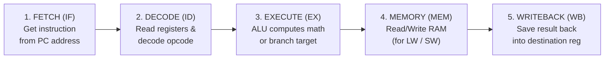
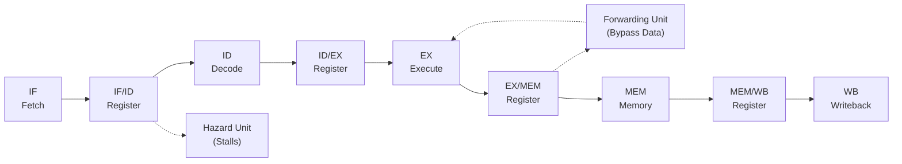

# RISC-V Processor Project (Phase I: Single-Cycle Prototype)

Welcome to the **RISC-V Processor Project**. This repository contains the complete design, Verilog implementation, and simulation environment for a **32-bit single-cycle RISC-V processor**.

This work represents **Phase I** of an ongoing two-phase computer architecture project. The ultimate goal is to build a full **5-Stage Pipelined RISC-V Processor** in Phase II. In this phase, we have designed, implemented, and verified the core single-cycle execution engine.

---

## Prototype Video

**[Watch the Phase I prototype video on Google Drive](https://drive.google.com/drive/folders/1uSRVT-m7kjx9ZaAxFc_7RNzCOR-aKLWm)** (4 min 51 s)

The video covers the project idea, the team, the stage-partitioned datapath (Fig. 1), the key Verilog modules, a live `make test-arithmetic` run with its waveform, and the known limitations and Phase II plan.

---

## Table of Contents
1. [What This Project Is](#1-what-this-project-is)
2. [Why We Are Building It](#2-why-we-are-building-it)
3. [What is RISC-V?](#3-what-is-risc-v)
4. [What Does "Single-Cycle" Mean?](#4-what-does-single-cycle-mean)
5. [How an Instruction Moves Through the Processor](#5-how-an-instruction-moves-through-the-processor)
6. [Detailed Explanation of Each Verilog Module](#6-detailed-explanation-of-each-verilog-module)
7. [How the Control Unit Works](#7-how-the-control-unit-works)
8. [How the ALU Works](#8-how-the-alu-works)
9. [How Registers and Memory Work](#9-how-registers-and-memory-work)
10. [Supported Instructions](#10-supported-instructions)
11. [How the Test Programs Work](#11-how-the-test-programs-work)
12. [How to Compile and Run the Simulation](#12-how-to-compile-and-run-the-simulation)
13. [How to Inspect Waveforms Using Surfer](#13-how-to-inspect-waveforms-using-surfer)
14. [What We Have Successfully Tested](#14-what-we-have-successfully-tested)
15. [What is Incomplete (Known Limitations)](#15-what-is-incomplete-known-limitations)
16. [Future Work: Transition to a 5-Stage Pipeline](#16-future-work-transition-to-a-5-stage-pipeline)

---

## 1. What This Project Is

This project is a hardware implementation of a **32-bit RISC-V processor core** written from scratch in standard Verilog HDL. 

Key characteristics of our processor:
- **Architecture:** RV32I subset (32-bit RISC-V Base Integer Instruction Set).
- **Execution Style:** Single-Cycle. Each instruction completes its entire journey (fetch, decode, execute, memory, and writeback) within a single clock cycle.
- **Stage-Aware Organization:** To make upgrading to a 5-stage pipeline easy in Phase II, we modularized the single-cycle design into five logical stage blocks: Fetch (`if_stage`), Decode (`id_stage`), Execute (`ex_stage`), Memory (`mem_stage`), and Writeback (`wb_stage`).

---

## 2. Why We Are Building It

Building a pipelined processor directly from scratch is notoriously difficult because you must deal with two huge problems at the same time:
1. **Core Functionality:** Getting the math (ALU), memory access, registers, and branch logic to work correctly.
2. **Pipelining Hazards:** Handling pipeline registers, data dependencies (hazard forwarding), and branch penalties.

By first building a **modular single-cycle processor in Phase I**, we prove that every arithmetic operation, register read/write, memory access, and branch calculation works 100% correctly in hardware. Once this foundation is proven, transitioning to a pipelined core in Phase II becomes a clean, manageable engineering task of inserting pipeline registers and forwarding logic.

---

## 3. What is RISC-V?

**RISC** stands for *Reduced Instruction Set Computer*. Unlike older processor architectures (like x86 found in standard PCs) which have hundreds of complicated, variable-length instructions, a RISC processor uses a small set of simple, uniform instructions.

**RISC-V** (pronounced *"risk-five"*) is an open-source, royalty-free instruction set architecture created at UC Berkeley in 2010.

### Why RISC-V is Great for Hardware Design:
- **Fixed 32-bit Length:** Every instruction is exactly 32 bits long (4 bytes). The processor never has to guess how long an instruction is.
- **Uniform Register Locations:** In almost all instructions, the source registers (`rs1`, `rs2`) and the destination register (`rd`) are located at the exact same bit positions inside the 32-bit instruction word.
- **Predictable Immediate Sign Bit:** The sign bit of every immediate constant is always located at bit `[31]`. This makes immediate decoding logic very simple and fast.

---

## 4. What Does "Single-Cycle" Mean?

In a **single-cycle processor**:
- The clock ticks at a constant frequency (in our simulation, once every $10\,\text{ns}$, which corresponds to $100\,\text{MHz}$).
- In that single $10\,\text{ns}$ period, the processor does **everything** for that instruction:
  1. Reads the instruction from memory using the Program Counter.
  2. Reads the register file and decodes the opcode.
  3. Performs the math or logical operation in the ALU.
  4. Reads or writes to data memory (if it is a load or store instruction).
  5. Writes the final answer back to the destination register.
- At the next rising clock edge, the Program Counter updates to the next instruction address, and the destination register stores its new value.
- Therefore, **Cycles Per Instruction (CPI) = 1.0**.

---

## 5. How an Instruction Moves Through the Processor

Even though everything completes in one clock cycle, data physically flows through the processor along five classic stages:



1. **Instruction Fetch (`IF`):** The Program Counter (`PC`) holds the memory address of the instruction. That address is sent to Instruction Memory, which looks up the 32-bit machine code word. Meanwhile, an adder calculates `PC + 4` for the next sequential instruction.
2. **Instruction Decode (`ID`):** The 32-bit instruction word is split into fields:
   - The **Opcode** tells the Control Unit what kind of instruction it is.
   - The **Register Addresses** (`rs1` and `rs2`) tell the Register File which registers to read.
   - The **Immediate Generator** extracts any numeric constants embedded in the instruction and extends them to a full 32 bits.
3. **Execution (`EX`):** The Arithmetic Logic Unit (ALU) does the actual computation. For an `ADD`, it adds two register values; for a memory access (`LW` or `SW`), it calculates the memory address; for a branch (`BEQ`), it compares the two numbers to see if they are equal. At the same time, another adder computes the branch target address (`PC + offset`).
4. **Memory Access (`MEM`):** If the instruction is a Store Word (`SW`), the value is saved into Data Memory. If it is a Load Word (`LW`), the value is read out of Data Memory. For arithmetic instructions, this stage does nothing.
5. **Writeback (`WB`):** A multiplexer picks either the ALU result (for arithmetic) or the loaded memory data (for `LW`) and writes it back into the destination register (`rd`).

---

## 6. Detailed Explanation of Each Verilog Module

Every module in the [modules/](file:///Users/aditsingh/Desktop/mca_project/modules) directory has a dedicated role. Here is how each module works, what wires go into it, what wires come out, and why it is needed:

---

### 1. Program Counter — [`modules/pc.v`](file:///Users/aditsingh/Desktop/mca_project/modules/pc.v)
- **Purpose:** A 32-bit register that stores the memory address of the instruction currently being executed.
- **Inputs:**
  - `clk` (Clock): The heartbeat of the system.
  - `rst` (Reset): When high, resets the program counter back to address `0x00000000`.
  - `p_nxt[31:0]` (Next PC): The address of the next instruction (either `PC + 4` or a branch target).
- **Outputs:**
  - `p_out[31:0]` (Current PC): The active 32-bit instruction address.
- **Interaction:** `p_out` is sent to Instruction Memory to fetch the instruction and to an adder to calculate the next address.
- **Why it is needed:** Without a Program Counter, the processor would not know which instruction to execute or where to go next.

---

### 2. Adder — [`modules/adder.v`](file:///Users/aditsingh/Desktop/mca_project/modules/adder.v)
- **Purpose:** A pure combinational addition circuit that computes `out = a + b`.
- **Inputs:**
  - `a[31:0]`: First 32-bit input number.
  - `b[31:0]`: Second 32-bit input number.
- **Outputs:**
  - `out[31:0]`: 32-bit sum.
- **Interaction:**
  - Used in `if_stage` with `b = 32'd4` to calculate `PC + 4`.
  - Used in `ex_stage` to calculate branch destinations (`PC + immediate_offset`).
- **Why it is needed:** Dedicated adders allow the processor to calculate next-PC addresses in parallel with the main ALU performing data calculations.

---

### 3. 2-to-1 Multiplexer — [`modules/mux2.v`](file:///Users/aditsingh/Desktop/mca_project/modules/mux2.v)
- **Purpose:** A hardware data selector. It chooses between two 32-bit inputs based on a 1-bit selector signal (`sel`).
- **Inputs:**
  - `in0[31:0]`: Value chosen when `sel == 0`.
  - `in1[31:0]`: Value chosen when `sel == 1`.
  - `sel`: The 1-bit control decision wire.
- **Outputs:**
  - `out[31:0]`: The selected 32-bit value.
- **Interaction:**
  - **PC Mux (`if_stage`):** Chooses between `PC + 4` and branch target based on `pc_src`.
  - **ALU Operand Mux (`ex_stage`):** Chooses between register value `read_data2` and `imm_out` based on `alu_src`.
  - **Writeback Mux (`wb_stage`):** Chooses between ALU result and Data Memory output based on `mem_to_reg`.
- **Why it is needed:** Hardware multiplexers route data dynamically depending on what kind of instruction is executing.

---

### 4. Instruction Memory — [`modules/instr_mem.v`](file:///Users/aditsingh/Desktop/mca_project/modules/instr_mem.v)
- **Purpose:** Holds the program instructions. It is organized as 64 words of 32 bits each (256 bytes total).
- **Inputs:**
  - `read_address[31:0]`: The byte address coming from the Program Counter.
- **Outputs:**
  - `instruction[31:0]`: The 32-bit machine code instruction word.
- **How it works:** In RISC-V, instructions are 4 bytes wide and aligned on 4-byte boundaries (`0x00`, `0x04`, `0x08`, `0x0C`). Therefore, the lower two bits of the address are always `00`. The module indexes the internal word array using `read_address[7:2]`, which divides the byte address by 4 without any hardware delay.
- **Interaction:** Receives the address from `pc.v` and delivers the machine code word to the `id_stage` (Control Unit, Register File, and Immediate Generator).
- **Why it is needed:** The processor must have a place to read its program instructions.

---

### 5. Register File — [`modules/reg_file.v`](file:///Users/aditsingh/Desktop/mca_project/modules/reg_file.v)
- **Purpose:** Contains the 32 general-purpose 32-bit registers (`x0` through `x31`).
- **Inputs:**
  - `clk`: Clock signal for writes.
  - `write_enable`: Control signal; when `1`, enables writing to register `rd`.
  - `rs1[4:0]`: 5-bit address of source register 1 ($2^5 = 32$ possibilities).
  - `rs2[4:0]`: 5-bit address of source register 2.
  - `rd[4:0]`: 5-bit address of the destination register.
  - `write_data[31:0]`: 32-bit value to store into `rd`.
- **Outputs:**
  - `read_data1[31:0]`: Current 32-bit value stored in register `rs1`.
  - `read_data2[31:0]`: Current 32-bit value stored in register `rs2`.
- **Key Hardware Rules:**
  - **Dual Asynchronous Reads:** Reading is combinational and instantaneous. As soon as `rs1` or `rs2` changes, the output updates without waiting for a clock tick.
  - **Single Synchronous Write:** Writing only occurs on the rising edge of `clk` when `write_enable == 1`.
  - **Register `x0` is hardwired to Zero:** The architecture enforces `assign read_data1 = (rs1 == 5'b0) ? 32'b0 : register[rs1];`. Writing to `x0` is strictly ignored (`rd != 5'b0`).
- **Why it is needed:** Registers provide the ultra-fast working memory for holding variables during computation.

---

### 6. Immediate Generator — [`modules/imm_gen.v`](file:///Users/aditsingh/Desktop/mca_project/modules/imm_gen.v)
- **Purpose:** Extracts numbers (constants/offsets) embedded directly inside instructions and sign-extends them into full 32-bit values.
- **Inputs:**
  - `instruction[31:0]`: The full 32-bit instruction word.
  - `src[1:0]`: 2-bit format selector from the Control Unit:
    - `2'b00` = I-Type (`ADDI`, `LW`)
    - `2'b01` = S-Type (`SW`)
    - `2'b10` = B-Type (`BEQ`, `BNE`)
    - `2'b11` = J-Type (`JAL`)
- **Outputs:**
  - `out[31:0]`: The 32-bit signed immediate constant.
- **How it works:** In RISC-V, bit `[31]` is always the sign bit. The module precalculates a 20-bit padding mask (`20'hFFFFF` if negative, `20'h00000` if positive) and pieces together the split bit fields according to the selected format.
- **Why it is needed:** Machine instructions are only 32 bits long, so immediate numbers are small (12 bits). The ALU requires both of its inputs to be 32 bits wide, so sign-extension is mandatory.

---

### 7. Main Control Unit — [`modules/control_unit.v`](file:///Users/aditsingh/Desktop/mca_project/modules/control_unit.v)
- **Purpose:** The "brain" of the processor. It inspects the 7-bit opcode (`instruction[6:0]`) and sets the control signals across the datapath.
- **Inputs:**
  - `opcode[6:0]`: The 7-bit instruction opcode field.
- **Outputs:**
  - `reg_write`: Enables writing the result into the destination register.
  - `imm_src[1:0]`: Tells the immediate generator which format to decode.
  - `alu_src`: Selects ALU operand B (`0` = register `read_data2`, `1` = immediate `imm_out`).
  - `mem_read`: Enables reading from data memory.
  - `mem_write`: Enables writing to data memory.
  - `mem_to_reg`: Selects writeback data (`0` = ALU result, `1` = memory read data).
  - `branch`: Indicates that the instruction is a conditional branch.
  - `alu_op[1:0]`: Broad operation category sent to `alu_control`.
- **Why it is needed:** Different instructions need different hardware paths activated. The control unit coordinates the multiplexers and memory read/write enables.

---

### 8. ALU Control Unit — [`modules/alu_control.v`](file:///Users/aditsingh/Desktop/mca_project/modules/alu_control.v)
- **Purpose:** Takes the broad 2-bit category from the Main Control Unit (`alu_op`) and combines it with the instruction's `funct3` and `funct7` fields to determine the exact 4-bit operation code for the ALU.
- **Inputs:**
  - `alu_op[1:0]`: Broad operation code (`00` = memory add, `01` = branch subtract, `10` = R-type/I-type).
  - `funct3[2:0]`: 3-bit sub-function code from `instruction[14:12]`.
  - `funct7[6:0]`: 7-bit sub-function code from `instruction[31:25]`.
- **Outputs:**
  - `control_alu[3:0]`: 4-bit selector wire sent to the ALU.
- **Why it is needed:** RISC-V uses a two-level control scheme. This keeps the Main Control Unit simple and delegates instruction-specific math decoding to the smaller ALU control block.

---

### 9. Arithmetic Logic Unit (ALU) — [`modules/alu.v`](file:///Users/aditsingh/Desktop/mca_project/modules/alu.v)
- **Purpose:** Performs the actual arithmetic calculation or logical comparison.
- **Inputs:**
  - `a[31:0]`: First 32-bit operand (always from `read_data1`).
  - `b[31:0]`: Second 32-bit operand (either `read_data2` or `imm_out`).
  - `control_alu[3:0]`: 4-bit operation code.
- **Outputs:**
  - `result_alu[31:0]`: The 32-bit result.
  - `zero`: A 1-bit flag that asserts high (`1'b1`) whenever `result_alu == 0`.
- **Supported Operations:**
  - `4'b0000`: Bitwise AND (`a & b`)
  - `4'b0001`: Bitwise OR (`a | b`)
  - `4'b0010`: Addition (`a + b`)
  - `4'b0110`: Subtraction (`a - b`)
  - `4'b0100`: Bitwise XOR (`a ^ b`)
- **Why it is needed:** The ALU is the fundamental calculation engine of any computer processor.

---

### 10. Branch Unit — [`modules/branch_unit.v`](file:///Users/aditsingh/Desktop/mca_project/modules/branch_unit.v)
- **Purpose:** Evaluates whether a branch condition has succeeded.
- **Inputs:**
  - `branch`: 1-bit signal from Control Unit indicating this is a branch instruction.
  - `funct3[2:0]`: Tells whether it is `BEQ` (`3'b000`) or `BNE` (`3'b001`).
  - `zero`: The 1-bit equality comparison flag from the ALU.
- **Outputs:**
  - `pc_src`: Controls the next-PC multiplexer (`0` = sequential `PC + 4`, `1` = branch target).
- **How it works:**
  - For `BEQ` (Branch if Equal): If `branch == 1` and `zero == 1` (meaning $a - b = 0$), then `pc_src = 1`.
  - For `BNE` (Branch if Not Equal): If `branch == 1` and `zero == 0` (meaning $a - b \neq 0$), then `pc_src = 1`.
- **Why it is needed:** It makes the final decision on whether the Program Counter jumps or continues sequentially.

---

### 11. Data Memory — [`modules/data_mem.v`](file:///Users/aditsingh/Desktop/mca_project/modules/data_mem.v)
- **Purpose:** The processor's RAM (Read/Write Data Memory). It holds 64 words of 32 bits (256 bytes).
- **Inputs:**
  - `clk`: Clock signal for writes.
  - `mem_read`: When `1`, enables reading from memory.
  - `mem_write`: When `1`, enables writing to memory.
  - `address[31:0]`: Memory byte address calculated by the ALU.
  - `write_data[31:0]`: Data value to store (comes from register `read_data2`).
- **Outputs:**
  - `read_data[31:0]`: 32-bit data word read out of memory.
- **Operation:**
  - Writes are **synchronous**: data is latched into `memory[address[7:2]]` on `posedge clk` when `mem_write == 1`.
  - Reads are **asynchronous**: when `mem_read == 1`, data appears immediately. When `mem_read == 0`, `read_data` outputs `32'b0`.
- **Why it is needed:** Programs need temporary memory to store variables that do not fit in the 32 registers (`SW` and `LW`).

---

### 12. Top-Level Core & Stage Wrappers
- **`if_stage.v`:** Groups `pc`, `adder` (`PC+4`), `mux2`, and `instr_mem`.
- **`id_stage.v`:** Groups `control_unit`, `reg_file`, and `imm_gen`.
- **`ex_stage.v`:** Groups `mux2` (ALU source), `alu_control`, `alu`, `adder` (branch target), and `branch_unit`.
- **`mem_stage.v`:** Houses `data_mem`.
- **`wb_stage.v`:** Houses the writeback selection multiplexer.
- **`riscv_single_cycle.v`:** Top-level module interconnecting the five stage wrappers combinationally.
- **`tb_riscv.v`:** The simulation testbench. Generates clock (`10ns` period) and reset (`15ns` duration), dumps waveforms to `riscv_single_cycle.vcd`, and runs execution.

---

## 7. How the Control Unit Works

The Control Unit inspects `instruction[6:0]` (the 7-bit opcode) and sets the following control signals:

| Instruction Type | Opcode | `reg_write` | `imm_src` | `alu_src` | `mem_read` | `mem_write` | `mem_to_reg` | `branch` | `alu_op` |
|:---|:---:|:---:|:---:|:---:|:---:|:---:|:---:|:---:|:---:|
| **R-Type** (`ADD`, `SUB`, `AND`, `OR`, `XOR`) | `0110011` | `1` | `00` | `0` (Reg) | `0` | `0` | `0` (ALU) | `0` | `10` |
| **I-Type ALU** (`ADDI`) | `0010011` | `1` | `00` | `1` (Imm) | `0` | `0` | `0` (ALU) | `0` | `10` |
| **Load** (`LW`) | `0000011` | `1` | `00` | `1` (Imm) | `1` | `0` | `1` (MEM) | `0` | `00` |
| **Store** (`SW`) | `0100011` | `0` | `01` | `1` (Imm) | `0` | `1` | `0` (X) | `0` | `00` |
| **Branch** (`BEQ`, `BNE`) | `1100011` | `0` | `10` | `0` (Reg) | `0` | `0` | `0` (X) | `1` | `01` |

---

## 8. How the ALU Works

The ALU takes inputs $A$ and $B$ and computes an output based on the 4-bit `control_alu` code:

| `control_alu` | Operation | Verilog Logic | Used By |
|:---:|:---:|:---:|:---|
| `4'b0000` | AND | `result_alu = a & b;` | `AND` |
| `4'b0001` | OR | `result_alu = a \| b;` | `OR` |
| `4'b0010` | ADD | `result_alu = a + b;` | `ADD`, `ADDI`, `LW`, `SW` |
| `4'b0110` | SUB | `result_alu = a - b;` | `SUB`, `BEQ`, `BNE` |
| `4'b0100` | XOR | `result_alu = a ^ b;` | `XOR` |

The `zero` flag is generated simply as:
```verilog
assign zero = (result_alu == 32'b0) ? 1'b1 : 1'b0;
```
For branch instructions, the ALU subtracts $a - b$. If $a == b$, the result is $0$, which automatically makes `zero = 1`!

---

## 9. How Registers and Memory Work

### Register File Behavior:
- Contains 32 registers (`x0` to `x31`).
- You can read **two registers at the same time** (`rs1` and `rs2`) purely combinationally.
- You can write to **one register** (`rd`) at the rising clock edge when `reg_write == 1`.
- Register `x0` is permanently wired to value `0`.

### Data Memory Behavior:
- Organized as 64 words (256 bytes).
- Indexed in 4-byte increments using `address[7:2]`.
- Writing happens on the rising clock edge when `mem_write == 1`.
- Reading happens combinationally when `mem_read == 1`.

---

## 10. Supported Instructions

The Phase I processor supports 10 core RV32I instructions:

| Instruction | Type | Syntax | Operation Performed | Verified? |
|:---|:---:|:---|:---|:---:|
| **ADD** | R | `add rd, rs1, rs2` | $rd = rs1 + rs2$ | **Yes** |
| **SUB** | R | `sub rd, rs1, rs2` | $rd = rs1 - rs2$ | **Yes** |
| **AND** | R | `and rd, rs1, rs2` | $rd = rs1 \ \& \ rs2$ | **Yes** |
| **OR** | R | `or rd, rs1, rs2` | $rd = rs1 \mid rs2$ | **Yes** |
| **XOR** | R | `xor rd, rs1, rs2` | $rd = rs1 \oplus rs2$ | **Yes** |
| **ADDI** | I | `addi rd, rs1, imm` | $rd = rs1 + imm$ (positive values) | **Yes** |
| **LW** | I | `lw rd, offset(rs1)` | $rd = \text{Memory}[rs1 + offset]$ | **Yes** |
| **SW** | S | `sw rs2, offset(rs1)` | $\text{Memory}[rs1 + offset] = rs2$ | **Yes** |
| **BEQ** | B | `beq rs1, rs2, label` | If $rs1 == rs2 \rightarrow PC += offset$ | **Yes** |
| **BNE** | B | `bne rs1, rs2, label` | If $rs1 \neq rs2 \rightarrow PC += offset$ | Hardware present |

---

## 11. How the Test Programs Work

The repository includes three verified test programs. The machine code `.hex` files live in the root directory, and the human-readable assembly source files live in [tests/](file:///Users/aditsingh/Desktop/mca_project/tests):

### Test 1: Branch Test ([`tests/branch_test.asm`](file:///Users/aditsingh/Desktop/mca_project/tests/branch_test.asm) / `program.hex`)
Verifies conditional branching with `BEQ`:
```assembly
addi x1, x0, 5       # x1 = 5
addi x2, x0, 5       # x2 = 5
beq  x1, x2, target  # 5 == 5, so branch is TAKEN! Jumps over the next instruction!
addi x3, x0, 99      # Bypassed instruction (should NEVER execute)
target:
addi x4, x0, 10      # Target instruction: executes successfully (x4 = 10)
```
- **Observed Behavior:** Instruction at PC `0x0C` (`addi x3, x0, 99`) is skipped completely. Next PC jumps directly to `0x10` (`addi x4, x0, 10`).

### Test 2: Arithmetic & Logic Test ([`tests/arithmetic_test.asm`](file:///Users/aditsingh/Desktop/mca_project/tests/arithmetic_test.asm) / `program_arithmetic.hex`)
Verifies ALU math and logic:
```assembly
addi x1, x0, 5       # x1 = 5
addi x2, x0, 10      # x2 = 10
add  x3, x1, x2      # x3 = 5 + 10 = 15  (0x0F)
sub  x4, x1, x2      # x4 = 5 - 10 = -5  (0xFFFFFFFB)
and  x5, x1, x2      # x5 = 5 & 10 = 0   (0x00)
or   x6, x1, x2      # x6 = 5 | 10 = 15  (0x0F)
xor  x7, x1, x2      # x7 = 5 ^ 10 = 15  (0x0F)
```
- **Observed Behavior:** All calculations match expected theoretical values in the simulation waveform.

### Test 3: Memory Store & Load Test ([`tests/memory_test.asm`](file:///Users/aditsingh/Desktop/mca_project/tests/memory_test.asm) / `program_memory.hex`)
Verifies RAM writing and reading:
```assembly
addi x1, x0, 42      # x1 = 42 (0x2A)
sw   x1, 0(x0)       # Store 42 into Data Memory address 0
lw   x2, 0(x0)       # Load value at address 0 into x2 (should be 42)
```
- **Observed Behavior:** Value `42` (`0x2A`) is written to memory in cycle 2, then read into register `x2` in cycle 3.

---

## 12. How to Compile and Run the Simulation

We use **Icarus Verilog (`iverilog`)** and the **`vvp`** runtime engine.

### Quick Commands via Makefile:
```bash
# Run default simulation (Branch test)
make sim

# Run specific tests:
make test-branch       # Runs the BEQ branch test
make test-arithmetic   # Runs the ADD, SUB, AND, OR, XOR test
make test-memory       # Runs the SW and LW test

# Clean up simulation output files:
make clean
```

### Or Compile Manually via Terminal:
```bash
# 1. Compile the processor testbench
iverilog -o sim.out modules/tb_riscv.v

# 2. Run simulation
vvp sim.out
```
When simulation runs, it generates the waveform file: `riscv_single_cycle.vcd`.

---

## 13. How to Inspect Waveforms Using Surfer

**Surfer** is a fast, modern waveform viewer written in Rust.

### Method 1: Using Surfer in Your Browser (No Installation Required!)
1. Open your web browser and go to: **[https://surfer-project.org](https://surfer-project.org)**
2. Click **Open file** (or drag and drop) and select **`riscv_single_cycle.vcd`** from your project folder.
3. In the signal scope panel on the left, navigate to `tb_riscv` $\rightarrow$ `uut`.
4. Click on the following recommended signals to add them to your waveform view:
   - `clk` (Clock)
   - `rst` (Reset)
   - `p_out[31:0]` (Program Counter)
   - `instruction[31:0]` (Instruction machine code)
   - `read_data1[31:0]`, `read_data2[31:0]` (Register values)
   - `result_alu[31:0]` (ALU output)
   - `write_data[31:0]` (Data written to register file)
   - `pc_src` (Branch selector)

### Method 2: Using Desktop Surfer / GTKWave
If you have Surfer installed locally via cargo:
```bash
surfer riscv_single_cycle.vcd
```
Or if you prefer GTKWave:
```bash
gtkwave riscv_single_cycle.vcd &
```

---

## 14. What We Have Successfully Tested

The existing waveform screenshots in [evidences/](file:///Users/aditsingh/Desktop/mca_project/evidences) demonstrate the following verified behavior:

1. **PC Reset & Sequential Stepping:**
   - `01_pc_reset_verification.png`: Shows PC staying at `0` during reset, then advancing `0x00, 0x04, 0x08, 0x0C...` every cycle after reset is released.
2. **Instruction Fetch:**
   - `02_instruction_fetch.png`: Shows correct 32-bit machine code being read from instruction memory as PC increments.
3. **Dual Register File Reads:**
   - `03_register_file_read.png`: Shows register values $x1 = 5$ and $x2 = 10$ appearing instantaneously on `read_data1` and `read_data2`.
4. **Immediate Generation:**
   - `04_immediate_generation.png`: Shows correct sign-extension of I-type immediates.
5. **Control Unit Decoding:**
   - `05_control_unit_verification.png`: Shows control wires changing dynamically based on instruction opcode.
6. **ALU Arithmetic & Logic:**
   - `06_alu_arithmetic.png`: Shows `ADD` producing `15` (`0x0F`) and `SUB` producing `-5` (`0xFFFFFFFB`).
   - `07_alu_logical.png`: Shows bitwise `AND`, `OR`, and `XOR` producing exact Boolean outputs.
7. **Data Memory Roundtrip:**
   - `08_sw_lw_waveform.png` & `09_data_memory_read_verification.png`: Shows `SW` writing `42` (`0x2A`) into memory, followed by `LW` loading `42` into register `x2`.
8. **Conditional Branching (BEQ):**
   - `11_beq_taken_verification.png`: Shows `zero` asserting high when comparing $5 == 5$, setting `pc_src = 1`, and causing the PC to branch to `0x10`, bypassing `0x0C`.
9. **Overall Single-Cycle Performance:**
   - `performance.png`: Shows each instruction retiring in exactly 1 clock cycle ($CPI = 1.0$).

---

## 15. What is Incomplete (Known Limitations)

Being honest and clear about limitations is essential in engineering evaluations:

1. **`ADDI` Immediate Bit-10 Bug in `alu_control.v`:**
   - In `modules/alu_control.v`, line 19 checks `funct7[5]` (`instruction[30]`) whenever `alu_op == 2'b10` and `funct3 == 3'b000`.
   - For R-type instructions (`ADD` vs `SUB`), this is correct.
   - But for I-type `ADDI`, `funct7` does not exist—instruction bit `[30]` is actually immediate bit `10`!
   - If you run an `ADDI` with a negative number or a value $\ge 1024$, bit 30 will be `1`, causing the processor to mistakenly execute a `SUB` instead of `ADD`. (This passed our tests because our test programs only used small positive numbers like `5`, `10`, and `42`).
2. **Untaken Branches Unverified:**
   - While `branch_unit.v` has code for `BNE` and fall-through, our test program only verified a taken `BEQ` branch.
3. **Memory Size & Access Alignment:**
   - Memory is 64 words (256 bytes) and only supports word-aligned 32-bit accesses (`LW` and `SW`). Byte or halfword operations (`LB`, `LH`, `SB`, `SH`) are not implemented.
4. **J-Type Instructions (`JAL`):**
   - The immediate generator decodes J-type formats, but `JAL` opcode `0x6F` is not decoded in `control_unit.v`.

---

## 16. Future Work: Transition to a 5-Stage Pipeline

In **Phase II**, we will upgrade this verified single-cycle prototype into a classic 5-stage pipelined processor:



### Steps for Phase II:
1. **Insert 4 Pipeline Registers:** Place registers between stages (`IF/ID`, `ID/EX`, `EX/MEM`, `MEM/WB`) to hold instructions, data, and control signals across clock cycles.
2. **Add a Forwarding Unit:** Route values directly from `EX/MEM` or `MEM/WB` back to the ALU inputs, eliminating Read-After-Write (RAW) data hazard delays.
3. **Add a Hazard Detection Unit:** Detect when an instruction right after a `LW` needs the loaded data (Load-Use hazard) and automatically insert a 1-cycle stall bubble.
4. **Fix the `ADDI` Bit-10 Bug:** Separate R-type and I-type ALU decoding in `alu_control.v`.
5. **Handle Branch Flush:** Clear speculatively fetched instructions if a branch is taken.

---

## Summary of Markdown Files in This Project

To keep everything clean and prevent confusion, this project contains only **two** documentation files:

1. **`README.md` (This file):** The complete guide to understanding, compiling, simulating, and explaining the processor.
2. **`docs/report.md`:** The concise, formal academic report structured with the 5 required sections: Abstract, Literature Review, Proposed Solution, Individual Contributions, and References.
