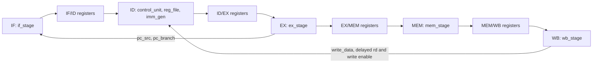

# Phase 2: Simple five-stage RISC-V pipeline

Phase 2 adds `riscv_pipeline` in [modules/riscv_pipeline.v](../modules/riscv_pipeline.v).
The Phase 1 `riscv_single_cycle` in [modules/riscv_single_cycle.v](../modules/riscv_single_cycle.v)
remains available as the comparison baseline. Both use the same ALU, decoder,
register-file implementation, and instruction/data memory models.

The Phase 2 scope is deliberately limited: four pipeline registers, EX-stage
branch redirection and flushing, reliable reset scheduling, executable verification,
and a reproducible performance comparison. There is **no forwarding, no hazard
detection, no automatic data stall, and no load-use stall**. Programs must be
scheduled in software.

## Architecture and clock boundaries



All four boundary registers are explicit `reg` signals in `riscv_pipeline` and
are updated by `always @(posedge clk)` blocks using nonblocking assignments.
The stage computation between them is combinational. The original `id_stage`
wrapper is used by Phase 1 only: Phase 2 instantiates its three leaf modules
directly, because the read instruction belongs to ID while the write destination
and write enable now belong to WB.

| Boundary | Signals in `riscv_pipeline` | Purpose |
|---|---|---|
| IF/ID | `if_id_valid`, `if_id_pc`, `if_id_instruction` | Hold the fetched instruction and its own PC for decode |
| ID/EX | `id_ex_valid`, `id_ex_pc`, `id_ex_read_data1`, `id_ex_read_data2`, `id_ex_imm`, `id_ex_rd`, `id_ex_funct3`, `id_ex_funct7`, `id_ex_alu_op`, `id_ex_reg_write`, `id_ex_alu_src`, `id_ex_mem_read`, `id_ex_mem_write`, `id_ex_mem_to_reg`, `id_ex_branch` | Hold operands, instruction fields, and controls for EX and later stages |
| EX/MEM | `ex_mem_valid`, `ex_mem_pc`, `ex_mem_result`, `ex_mem_store_data`, `ex_mem_rd`, `ex_mem_reg_write`, `ex_mem_mem_read`, `ex_mem_mem_write`, `ex_mem_mem_to_reg` | Hold address/result, store value, and memory/writeback controls |
| MEM/WB | `mem_wb_valid`, `mem_wb_pc`, `mem_wb_result`, `mem_wb_read_data`, `mem_wb_rd`, `mem_wb_reg_write`, `mem_wb_mem_to_reg` | Hold the two possible writeback values and the correct destination |

The PC fields in later boundaries also make verification traces easy to read;
they identify the instruction reaching completion. `valid=0` marks a reset or
branch-flush bubble, not a software NOP.

`u_reg_file` reads `if_id_instruction[19:15]` and `[24:20]` asynchronously.
Its rising-edge write uses `mem_wb_rd` and `write_data`, gated by
`wb_write_enable = mem_wb_valid && mem_wb_reg_write && !rst`.
The EX input mux selects the captured register operand or immediate. Store data
is captured independently as `ex_mem_store_data`; it is not the writeback mux output.
The data RAM writes on the MEM rising edge; its asynchronous load output is
captured into MEM/WB. The destination register is written at the following WB edge.

For an uninterrupted instruction stream, instruction 1 completes on active edge 5,
instruction 2 on edge 6, and so on. The first instruction's latency is five cycles;
steady throughput is one instruction per cycle when data and branch restrictions
do not introduce overhead.

## Software scheduling instead of data-hazard hardware

There must be **three intervening instructions** between a register producer and
a consumer that reads that register. Independent work may occupy these slots;
the supplied examples use three explicit `nop` instructions (`addi x0,x0,0`).
This applies to ALU operands, branch operands, store addresses, store data, and
values returned by `LW`.

| Instruction | Cycle 1 | Cycle 2 | Cycle 3 | Cycle 4 | Cycle 5 | Cycle 6 |
|---|---|---|---|---|---|---|
| Producer | IF | ID | EX | MEM | WB | |
| NOP 1 | | IF | ID | EX | MEM | WB |
| NOP 2 | | | IF | ID | EX | MEM |
| NOP 3 | | | | IF | ID | EX |
| Consumer | | | | | IF | ID |

With only two NOPs the consumer's ID/EX latch samples on the same rising edge
as the producer's register-file write. That write becomes visible after the
nonblocking update, too late for the consumer's capture. No WB-to-ID bypass or
falling-edge register write has been added. The regression demonstrates that
case: a producer of 5 followed by only two NOPs and `add x2,x1,x1` leaves `x2=0`
in the zero-initialized test fixture, rather than the architectural result 10.
With uninitialized hardware registers the wrong value could instead be unknown.

A `SW` immediately followed by `LW` to the same address needs no extra spacing
when its register operands were already ready: the store writes memory on the
edge before the load's MEM read is captured. A subsequent user of the loaded
register still needs the three intervening instructions.

Checked-in software-scheduled examples are:

| Assembly | Matching hex | Expected result |
|---|---|---|
| [tests/phase2_arithmetic_test.asm](../tests/phase2_arithmetic_test.asm) | [program_phase2_arithmetic.hex](../program_phase2_arithmetic.hex) | `x3=15`, `x4=0xFFFFFFFB`, `x5=0`, `x6=15`, `x7=15` |
| [tests/phase2_memory_test.asm](../tests/phase2_memory_test.asm) | [program_phase2_memory.hex](../program_phase2_memory.hex) | data word 0 and `x2` equal 42 |
| [tests/phase2_branch_test.asm](../tests/phase2_branch_test.asm) | [program_phase2_branch.hex](../program_phase2_branch.hex) | `x3` is not written; `x4=10` |

The root [program_branch.hex](../program_branch.hex) is corrected separately to
match the original [tests/branch_test.asm](../tests/branch_test.asm): the branch
at PC 8 targets PC 16. Its unscheduled dependency sequence is for Phase 1.
The Phase 2 version branches at PC 20 to PC 28 after three scheduling NOPs.

## Branch handling

The reused `ex_stage` in [modules/ex_stage.v](../modules/ex_stage.v) evaluates
BEQ/BNE from the captured operands and computes `pc_branch = id_ex_pc + id_ex_imm`.
Its `branch` input is qualified by `id_ex_valid` and `!rst`. On a taken branch,
`pc_src` redirects the PC through `if_stage`, and both IF/ID and ID/EX are cleared
at that rising edge. The branch itself and older instructions continue through
EX/MEM and MEM/WB. These two discarded younger instructions cannot write registers
or memory. There is no architectural branch delay slot.

The target instruction is fetched again after redirection even if it happened
to occupy the discarded IF slot. Each taken branch therefore costs two cycles.
Untaken branches keep the sequential stream and do not flush. This is fixed
branch control, not data-hazard detection or a data stall.

## PC, reset, and simulation changes

- [modules/pc.v](../modules/pc.v): synchronous active-high reset and PC updates
  now use nonblocking assignments; the reset literal is explicitly 32 bits.
- [modules/tb_riscv.v](../modules/tb_riscv.v): reset releases on the second falling
  edge (20 ns), rather than racing a rising edge at 15 ns. Its legacy waveform
  run finishes at 140 ns. `+VCD=path` can select the waveform output.
- [modules/id_stage.v](../modules/id_stage.v) and `riscv_single_cycle`: Phase 1
  register and memory writes are disabled while reset is asserted. The header
  spelling is corrected to `include_stage.vh` for case-sensitive filesystems.
- `riscv_pipeline`: reset clears every pipeline boundary and blocks RF/RAM writes.
  No clock gate or PC stall enable is introduced.
- [modules/instr_mem.v](../modules/instr_mem.v): unfilled words initialize to NOPs,
  and `+PROGRAM=path` selects the hex image without overwriting `program.hex`.
  The old short hex files may still cause Icarus's informational "not enough
  words" warning; their unused entries retain NOPs. Regression images are padded
  to exactly 64 words and do not produce that warning.

Hardware reset still does **not** clear `reg_file.register` or `data_mem.memory`.
The verification fixture initializes those arrays to zero solely to make whole-state
comparisons and checks of wrong-path writes deterministic. This is not additional
reset circuitry in the processor.

## Build and verification

Requirements: Icarus Verilog (`iverilog` and `vvp`), Python 3, and Make. No Python
packages or RISC-V assembler are required. Run these commands from the repo root:

```sh
make test                 # Both cores, full regression and performance report
make test-pipeline        # Pipeline-only regression
make compare              # Same complete verification and comparison as make test
make sim-pipeline         # Checked Phase 2 branch run plus waveform
make test-branch          # Checked corrected Phase 1 branch program
make sim                 # Legacy Phase 1 waveform for the current program.hex
make sim PROGRAM=program_branch.hex
```

[tests/run_phase2.py](../tests/run_phase2.py) compiles the common
[modules/tb_phase2.v](../modules/tb_phase2.v) once for each architecture using
`-DPIPELINED` to select Phase 2. A small ISA reference model computes expected
results independently of the RTL controls. For each run the script checks:

1. All 32 register slots and all 64 data-memory words against the reference model.
2. Exact completed-instruction PC order, including NOPs, branches, and stores.
3. Expected cycle count, pipeline fill/drain, and branch penalties.
4. Equivalent final architectural state for the original and scheduled programs.

The harness also rejects RF/RAM write enables during reset, checks PC reset,
checks unchanged fixture arrays throughout reset, and times out if completion
is not reached. State is sampled 1 ns after the completion edge to observe
nonblocking writes. The PC trace treats MEM/WB arrival at the next rising edge
as completion for every valid instruction; stores update RAM one edge earlier.

The suite has 13 programs per architecture: arithmetic, memory round trip, the
corrected branch example, taken/untaken BEQ and BNE, backward branches, a dependent
ALU/store/load chain, nonzero memory base with negative offset, x0 suppression,
16 independent instructions, and a program beginning with a store for reset
write-enable checking. A further pipeline-only run demonstrates insufficient
software spacing as an expected limitation, not as a correct execution result.

Artifacts go under `.build/phase2/`: both compiled simulations, padded per-run
hex images, text logs, VCD waveforms, and `performance.md`. For example, open
`.build/phase2/branch_pipeline.vcd` and inspect `uut.if_id_*`, `uut.id_ex_*`,
`uut.ex_mem_*`, `uut.mem_wb_*`, `uut.pc_src`, and `uut.write_data`.
The Makefile no longer copies test images over the root `program.hex`.
`make clean` removes only `.build/`; historical evidence is preserved.

## Performance comparison and its limits

The measured table is in [phase2_performance.md](phase2_performance.md). Regenerate
that checked-in snapshot with:

```sh
python3 tests/run_phase2.py --report docs/phase2_performance.md
```

Let `U` be executed useful instructions, `S` executed software NOPs, and `B` taken
branches. For these tests, which end on a useful instruction:

- Phase 1 cycles: `U` (the unscheduled baseline images contain no executed NOPs).
- Phase 2 cycles: `U + S + 4 + 2*B`.
- Useful CPI: `cycles / U`; it includes scheduling and control overhead.
- Simulated execution time: `cycles * clock_period`.
- Speedup: `single_time / pipeline_time`.

Both test clocks are 10 ns. The time values use whole active-cycle accounting;
reset cycles and the final 1 ns observation delay are excluded. At that equal
clock, seven arithmetic instructions require 7 vs 14 cycles (70 vs 140 ns), and
16 independent instructions require 16 vs 20 cycles (160 vs 200 ns).
Thus these finite programs are slower on this pipeline at the equal clock.
NOPs, startup latency, and branch flushes account for the difference.

The potential hardware clock benefit comes from breaking the Phase 1 load path
(`PC -> instruction memory -> decode/register read -> ALU -> data memory -> WB`)
into shorter stage paths. A timing estimate would require, at minimum:

`T_single >= longest complete instruction path`

`T_pipeline >= max(actual stage path delays) + register timing overhead`

The EX branch-to-PC path and WB/register-file setup constraints must also be
included in real timing analysis. Stages are not necessarily balanced, and
register overhead is not zero. There is no measured maximum-frequency, area,
power, or physical timing result in this repository. The testbench's 100 MHz
clock is an input setting, not evidence that either hardware design meets it.

For a program taking `Cs` baseline cycles and `Cp` pipeline cycles, pipeline
frequency must exceed `(Cp/Cs) * single_frequency` to be faster. The performance
table reports that break-even ratio rather than inventing a fivefold speedup.

## Retained limitations

This phase does not extend the ISA or fix the existing ADDI bit-10 decoder bug
in [modules/alu_control.v](../modules/alu_control.v). For ADDI, immediate bit 10
selects subtraction for signed immediates -1024 through -1 and 1024 through 2047.
The supplied tests avoid those ADDI values; negative load/store/branch offsets
are separate encodings and are tested. Byte/halfword operations, jumps, traps,
and full illegal-encoding checks are still absent. The memories still index only
address bits `[7:2]` and silently alias high or unaligned addresses.

Phase 1 PDF/video reports and the screenshots in `evidences/` are historical
assets, not Phase 2 waveforms. Use the current RTL, this document, and the
regenerated verification artifacts for Phase 2 behavior.
