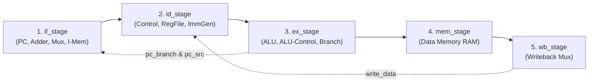

# Phase I Academic Project Report: Design and Verification of a Single-Cycle RV32I Processor Prototype

**Course / Project:** MCA Computer Architecture Laboratory  
**Team Members:** [Student Name 1], [Student Name 2], [Student Name 3] *(Input Required: Names & Roll Numbers)*  
**Institution:** Department of Computer Applications *(Input Required: Institution Name)*  
**Date:** November 2026  

---

## Abstract

This report details the architectural design, Verilog HDL implementation, and simulation-based verification of a 32-bit single-cycle RISC-V processor prototype implementing a subset of the RV32I base integer instruction set. Built as Phase I of a two-phase project that will culminate in a 5-stage pipelined processor, this prototype establishes a verified hardware foundation. The single-cycle datapath is intentionally partitioned into five modular stage wrappers: Instruction Fetch (`if_stage`), Instruction Decode (`id_stage`), Execution (`ex_stage`), Memory Access (`mem_stage`), and Writeback (`wb_stage`). The processor supports ten core instructions spanning arithmetic (`ADD`, `SUB`, `ADDI`), bitwise logic (`AND`, `OR`, `XOR`), memory access (`LW`, `SW`), and conditional branching (`BEQ`, `BNE`). Functional verification was performed using Icarus Verilog (`iverilog`) across compiled assembly test programs, with cycle-by-cycle correctness validated through Value Change Dump (`.vcd`) waveforms. A microarchitectural evaluation identifies critical limitations—including immediate bit-10 aliasing in the ALU control unit—and establishes the transition roadmap for pipeline register insertion, data forwarding, and hazard detection in Phase II.

---

## 1. Introduction & Background

Modern computer systems rely on streamlined Instruction Set Architectures (ISAs) to balance hardware complexity, performance, and power consumption. The open-standard RISC-V ISA has become the leading open architecture for academic instruction and commercial processor development.

In hardware engineering education, designing a 5-stage pipelined processor from scratch introduces concurrent challenges: datapath synthesis, hazard detection, data forwarding, and branch misprediction flushes. To manage this complexity, this project follows an incremental two-phase engineering process:
- **Phase I (This Report):** Implementation and verification of a **Single-Cycle RV32I Processor Prototype**. The datapath is pre-structured along the exact physical boundaries of the classic 5-stage pipeline, but connected combinationally so that each instruction completes in one clock cycle ($CPI = 1.0$).
- **Phase II (Future Work):** Insertion of inter-stage pipeline registers (`IF/ID`, `ID/EX`, `EX/MEM`, `MEM/WB`), synthesis of an Execution-Stage Forwarding Unit, and implementation of a Hazard Detection and Stall Unit.

---

## 2. Literature Review

The Reduced Instruction Set Computer (RISC) design philosophy originated with Patterson and Ditzel (1980), demonstrating that simple, uniform, single-cycle instruction execution with load-store architectures yields higher operational efficiency than complex, multi-cycle CISC architectures.

The RISC-V ISA was created in 2010 at the University of California, Berkeley by Waterman, Asanović, and Patterson. RISC-V was architected specifically to simplify hardware decoding:
1. **Fixed 32-bit Instruction Width:** Avoids variable-length instruction decoding overhead.
2. **Fixed Register Specifiers:** Source registers (`rs1`, `rs2`) and the destination register (`rd`) remain at fixed bit positions across formats.
3. **Uniform Immediate Sign Bit:** The immediate sign bit is permanently situated at bit `[31]`, decoupling sign-extension logic from format decoding.

In classic computer organization (Patterson and Hennessy, 2017), processors are classified into single-cycle, multi-cycle, and pipelined designs. In a single-cycle design, the clock cycle must accommodate the slowest instruction's critical path (typically `LW`), resulting in lower clock frequencies but an ideal instruction throughput of one cycle per instruction ($CPI = 1.0$). In a 5-stage pipelined design, the datapath is partitioned by clocked pipeline registers into Fetch (IF), Decode (ID), Execute (EX), Memory (MEM), and Writeback (WB), allowing multiple instructions to execute concurrently at higher clock frequencies.

The Phase I architecture implemented here realizes the single-cycle execution model while organizing the hardware modules into the identical five functional stages required for Phase II pipelining.

---

## 3. Proposed Solution

### 3.1 Single-Cycle Architecture and 5-Stage Modular Partitioning

The processor core (`riscv_single_cycle.v`) interconnects five functional stage blocks combinationally within a single 10 ns clock cycle ($100\,\text{MHz}$ simulation frequency):

1. **Instruction Fetch (`if_stage.v`):** Contains the 32-bit Program Counter (`pc.v`), a PC+4 incrementer (`adder.v`), a next-PC selection multiplexer (`mux2.v`), and the 64-word instruction memory (`instr_mem.v`).
2. **Instruction Decode (`id_stage.v`):** Contains the Main Control Unit (`control_unit.v`), the 32×32-bit Register File (`reg_file.v`), and the Immediate Generator (`imm_gen.v`).
3. **Execution (`ex_stage.v`):** Houses the ALU source multiplexer (`mux2.v`), the ALU Control Unit (`alu_control.v`), the 32-bit ALU (`alu.v`), a branch target adder (`adder.v`), and the Branch Decision Unit (`branch_unit.v`).
4. **Memory Access (`mem_stage.v`):** Contains the 64-word synchronous-write / asynchronous-read data memory (`data_mem.v`).
5. **Writeback (`wb_stage.v`):** Houses the 2-to-1 writeback multiplexer (`mux2.v`), which selects between the ALU result and the memory read data.

---

### 3.2 Datapath and Control Design

- **Dual-Read Synchronous-Write Register File:** Synthesizes 32 registers (`x0` to `x31`). Reads on `rs1` and `rs2` are combinational. Register `x0` is hardwired to zero (`read_data = (rs == 0) ? 0 : register[rs]`). Writes occur on `posedge clk` when `write_enable == 1` and `rd != 0`.
- **Immediate Generator:** Combines the constant sign bit (`instruction[31]`) with split bit slices to reconstruct 32-bit signed constants for I, S, B, and J formats.
- **Two-Level Control Scheme:** The Main Control Unit decodes the 7-bit opcode to establish datapath multiplexer routing and memory enables, generating a 2-bit category code (`alu_op`). The ALU Control Unit combines `alu_op`, `funct3`, and `funct7` to generate the 4-bit ALU operation selector.
- **ALU and Branch Unit:** The ALU executes ADD, SUB, AND, OR, and XOR, asserting the `zero` flag when the result is zero. The Branch Unit asserts `pc_src` when a branch instruction is active and the equality condition (`BEQ`: `zero == 1`, `BNE`: `zero == 0`) is met.

---

### 3.3 Supported Instruction Subset

| Instruction | Type | Opcode | Funct3 | Funct7 | Operation | Status |
|:---|:---:|:---:|:---:|:---:|:---|:---:|
| **ADD** | R | `0110011` | `000` | `0000000` | $rd = rs1 + rs2$ | Verified |
| **SUB** | R | `0110011` | `000` | `0100000` | $rd = rs1 - rs2$ | Verified |
| **AND** | R | `0110011` | `111` | `0000000` | $rd = rs1 \ \& \ rs2$ | Verified |
| **OR** | R | `0110011` | `110` | `0000000` | $rd = rs1 \mid rs2$ | Verified |
| **XOR** | R | `0110011` | `100` | `0000000` | $rd = rs1 \oplus rs2$ | Verified |
| **ADDI** | I | `0010011` | `000` | N/A | $rd = rs1 + imm$ (positive values) | Verified |
| **LW** | I | `0000011` | `010` | N/A | $rd = \text{Mem}[rs1 + offset]$ | Verified |
| **SW** | S | `0100011` | `010` | N/A | $\text{Mem}[rs1 + offset] = rs2$ | Verified |
| **BEQ** | B | `1100011` | `000` | N/A | If $rs1 == rs2$, $PC += offset$ | Verified |
| **BNE** | B | `1100011` | `001` | N/A | If $rs1 \neq rs2$, $PC += offset$ | Logic Present |

---

### 3.4 Verification Methodology and Waveform Observations

The design was simulated using Icarus Verilog (`iverilog`) and `vvp`. Three targeted assembly test programs were executed:

1. **Arithmetic & Logic Test (`program_arithmetic.hex`):**
   - Verified that $5 + 10 = 15$ (`ADD`), $5 - 10 = -5$ (`SUB`), $5 \ \& \ 10 = 0$ (`AND`), $5 \mid 10 = 15$ (`OR`), and $5 \oplus 10 = 15$ (`XOR`).
   - Waveform captures in `evidences/Stage3_Execution/06_alu_arithmetic.png` and `07_alu_logical.png` confirm exact theoretical values.
2. **Data Memory Roundtrip Test (`program_memory.hex`):**
   - Value `42` (`0x2A`) was stored to memory address `0` via `SW`, then successfully retrieved into register `x2` via `LW`.
   - Confirmed in `evidences/Stage3_Execution/08_sw_lw_waveform.png`.
3. **Conditional Branch Test (`program.hex`):**
   - Registers initialized to $x1 = 5$ and $x2 = 5$.
   - `beq x1, x2, +8` successfully detected equality, asserted `pc_src = 1`, and redirected the PC to `0x10`, bypassing `addi x3, x0, 99` at PC `0x0C`.
   - Confirmed in `evidences/Stage3_Execution/11_beq_taken_verification.png` and `performance.png`.

---

### 3.5 Hardware Limitations and Critical Inconsistencies

A rigorous review of the existing RTL revealed three important engineering limitations:
1. **`ADDI` Bit-10 Aliasing Bug in `alu_control.v`:** When `alu_op == 2'b10` and `funct3 == 3'b000`, the module inspects `funct7[5]` (`instruction[30]`) to decide between `ADD` and `SUB`. For I-type `ADDI`, bit `[30]` is actually immediate bit `10`. Any negative immediate or positive immediate $\ge 1024$ will cause `ADDI` to execute as a `SUB`.
2. **Untaken Branch Verification:** The hardware logic for fall-through branches and `BNE` is present in `branch_unit.v`, but was not tested in existing waveform evidence.
3. **Word-Only Memory Alignment:** Data memory depth is 64 words (256 bytes) and only supports 32-bit aligned accesses (`address[7:2]`). Byte or halfword operations (`LB`, `SB`, `LH`, `SH`) are not supported.

---

### 3.6 Transition Roadmap to 5-Stage Pipeline (Phase II)

In Phase II, the single-cycle prototype will be converted into a pipelined processor:
1. **Pipeline Register Insertion:** Four synchronous registers (`reg_if_id`, `reg_id_ex`, `reg_ex_mem`, `reg_mem_wb`) will be placed between the stage wrappers to isolate execution across clock cycles.
2. **Forwarding Unit:** An execution-stage forwarding unit will resolve Read-After-Write (RAW) data dependencies by routing values from `EX/MEM` and `MEM/WB` directly to ALU inputs.
3. **Hazard Detection Unit:** A load-use hazard detector will stall the PC and insert a 1-cycle bubble into `ID/EX` when an instruction depends on a preceding `LW`.
4. **Branch Flush:** A pipeline flush mechanism will clear speculatively fetched instructions in `IF/ID` and `ID/EX` on branch mispredictions.

---

## 4. Individual Contributions

*(Team Contribution Breakdown — To be filled by team members)*

| Team Member | Roll No. | Subsystem Responsibilities | Deliverables |
|:---|:---|:---|:---|
| **[Student Name 1]** | *[Roll No.]* | Instruction Fetch & Writeback | `pc.v`, `adder.v`, `instr_mem.v`, `if_stage.v`, `wb_stage.v`, simulation setup |
| **[Student Name 2]** | *[Roll No.]* | Instruction Decode & Logic | `reg_file.v`, `imm_gen.v`, `control_unit.v`, `id_stage.v`, test assembly programs |
| **[Student Name 3]** | *[Roll No.]* | Execution & Memory Access | `alu.v`, `alu_control.v`, `branch_unit.v`, `data_mem.v`, `ex_stage.v`, `mem_stage.v`, report documentation |

---

## 5. References

1. A. Waterman, K. Asanović, and D. A. Patterson, "The RISC-V Instruction Set Manual, Volume I: User-Level ISA, Document Version 2.2," EECS Dept., UC Berkeley, Tech. Rep. UCB/EECS-2017-156, May 2017.
2. D. A. Patterson and J. L. Hennessy, *Computer Organization and Design: The Hardware/Software Interface (RISC-V Edition)*, 1st ed., Cambridge, MA: Morgan Kaufmann, 2017.
3. D. A. Patterson and D. R. Ditzel, "The Case for the Reduced Instruction Set Computer," *ACM SIGARCH Computer Architecture News*, vol. 8, no. 6, pp. 25–33, Oct. 1980.
4. IEEE Standard for Verilog Hardware Description Language, *IEEE Std 1364-2005*, IEEE Computer Society, Apr. 2006.
5. Surfer Project: Extensible Waveform Viewer (https://surfer-project.org).
