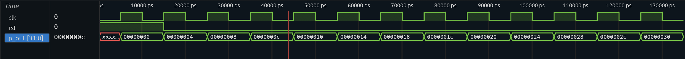
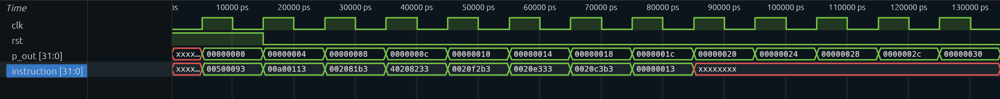

# Stage 1: Instruction Fetch (IF) — Waveform Evidence

This folder contains waveform screenshots verifying the **Instruction Fetch Stage** (`if_stage.v`).

---

## 1. `01_pc_reset_verification.png`

### Short Summary
This waveform proves that the **Program Counter (PC)** starts safely at address `0x00000000` when the reset signal is active, and then advances by 4 bytes every clock cycle after reset is released.

### Key Signals to Watch
- `clk`: Clock signal with a period of 10 ns (100 MHz).
- `rst`: Reset signal. Held HIGH (`1`) from 0 ps to 15000 ps (15 ns), then pulled LOW (`0`).
- `p_out[31:0]`: The current output address of the Program Counter register.

### The Hardware Logic Behind It
1. **Reset State (0 to 15 ns):**
   - In `pc.v`, the code states: `if (rst == 1) p_out = 32'b0;`.
   - While `rst` is high, `p_out` stays strictly at `00000000`. This ensures the processor doesn't execute random garbage on power-up.
2. **Sequential Counting (After 15 ns):**
   - The adder (`adder.v`) computes `p_nxt = p_out + 4`.
   - On every rising clock edge, `p_out` latches the next value:
     - At 20 ns: `p_out = 00000004`
     - At 30 ns: `p_out = 00000008`
     - At 40 ns: `p_out = 0000000c`
     - At 50 ns: `p_out = 00000010`
   - This proves that sequential instruction fetching works correctly ($PC + 4$).

---

## 2. `02_instruction_fetch.png`

### Short Summary
This waveform demonstrates that the **Instruction Memory** (`instr_mem.v`) reads the correct 32-bit machine code instruction corresponding to each Program Counter address.

### Key Signals to Watch
- `p_out[31:0]`: The byte address generated by the Program Counter.
- `instruction[31:0]`: The 32-bit instruction word read out of memory.

### The Hardware Logic Behind It
1. **Asynchronous Word Reading:**
   - In `instr_mem.v`, memory is read combinationally: `assign instruction = memory[read_address[7:2]];`.
   - Since every instruction is 4 bytes wide, the address increments by 4 (`0x00, 0x04, 0x08, 0x0C`). The lower two bits `[1:0]` are discarded, effectively dividing the address by 4.
2. **Matching the Program Code:**
   - At `p_out = 00000000`: `instruction = 00500093` (`addi x1, x0, 5`)
   - At `p_out = 00000004`: `instruction = 00a00113` (`addi x2, x0, 10`)
   - At `p_out = 00000008`: `instruction = 002081b3` (`add  x3, x1, x2`)
   - At `p_out = 0000000c`: `instruction = 40208233` (`sub  x4, x1, x2`)
   - At `p_out = 00000010`: `instruction = 0020f2b3` (`and  x5, x1, x2`)
   - At `p_out = 00000014`: `instruction = 0020e333` (`or   x6, x1, x2`)
   - At `p_out = 00000018`: `instruction = 0020c3b3` (`xor  x7, x1, x2`)
   - At `p_out = 0000001c`: `instruction = 00000013` (NOP)
3. **Conclusion:** As soon as the PC address updates, the correct machine code appears on the `instruction` bus without delay.
