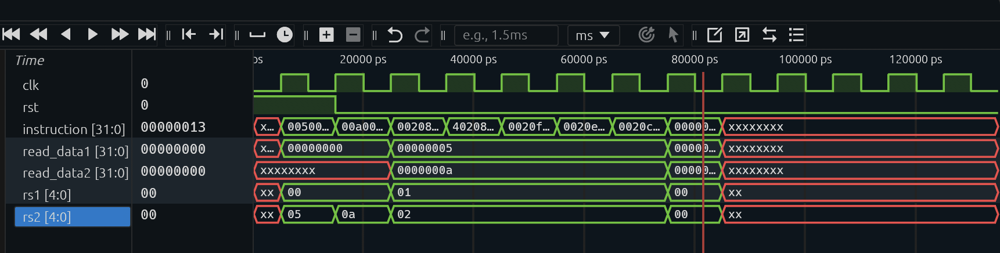
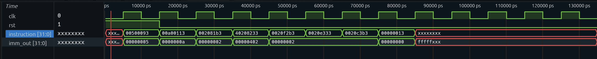
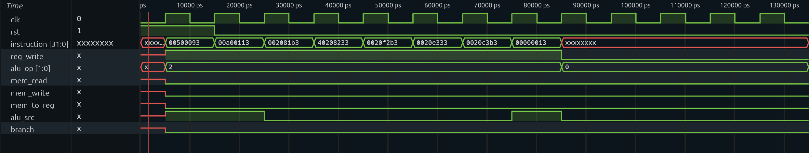

# Stage 2: Instruction Decode (ID) — Waveform Evidence

This folder contains waveform screenshots verifying the **Instruction Decode Stage** (`id_stage.v`).

---

## 1. `03_register_file_read.png`

### Short Summary
This waveform proves that the **Register File** (`reg_file.v`) can read two registers (`rs1` and `rs2`) simultaneously and output their stored values instantaneously.

### Key Signals to Watch
- `instruction[31:0]`: Active machine code instruction.
- `rs1[4:0]` (`instruction[19:15]`): First source register address.
- `rs2[4:0]` (`instruction[24:20]`): Second source register address.
- `read_data1[31:0]`: Data value read from register `rs1`.
- `read_data2[31:0]`: Data value read from register `rs2`.

### The Hardware Logic Behind It
1. **Instruction Being Executed:**
   - Instruction `002081b3` is `add x3, x1, x2`.
   - Here, `rs1 = 01` (register `x1`) and `rs2 = 02` (register `x2`).
2. **Dual Asynchronous Read:**
   - In earlier cycles, `x1` was loaded with `5` and `x2` was loaded with `10` (`0x0A`).
   - When `add x3, x1, x2` executes:
     - `read_data1` immediately outputs `00000005`.
     - `read_data2` immediately outputs `0000000a`.
3. **Conclusion:** Reading is combinational—both register ports deliver their values simultaneously without waiting for a clock edge.

---

## 2. `04_immediate_generation.png`

### Short Summary
This waveform proves that the **Immediate Generator** (`imm_gen.v`) correctly extracts numeric constants from instructions and sign-extends them into full 32-bit values.

### Key Signals to Watch
- `instruction[31:0]`: The incoming instruction.
- `imm_out[31:0]`: The 32-bit sign-extended immediate value.

### The Hardware Logic Behind It
1. **I-Type Extraction:**
   - For `00500093` (`addi x1, x0, 5`):
     - The top 12 bits (`instruction[31:20]`) hold the value `5`.
     - `imm_gen.v` sign-extends it to 32 bits, outputting `imm_out = 00000005`.
   - For `00a00113` (`addi x2, x0, 10`):
     - The top 12 bits hold `10` (`0x0A`).
     - `imm_gen.v` outputs `imm_out = 0000000a`.
2. **Handling R-Type Instructions:**
   - For instructions like `add` (`002081b3`), `imm_out` shows arbitrary sliced bits, but the ALU multiplexer chooses `read_data2` instead (`alu_src = 0`), safely ignoring `imm_out`.
3. **Conclusion:** Constants are properly converted to 32 bits so they can be fed directly into the ALU.

---

## 3. `05_control_unit_verification.png`

### Short Summary
This waveform proves that the **Main Control Unit** (`control_unit.v`) decodes the instruction opcode and generates the correct control signals to direct the processor datapath.

### Key Signals to Watch
- `instruction[31:0]`: Active instruction.
- `reg_write`: When `1`, enables writing result into destination register `rd`.
- `alu_src`: When `0`, ALU takes register data; when `1`, ALU takes immediate.
- `mem_read` / `mem_write`: Data memory read and write enables.
- `mem_to_reg`: Selects writeback data (`0` = ALU, `1` = Memory).
- `branch`: Indicates a conditional branch instruction.
- `alu_op[1:0]`: Category code sent to ALU Control (`10` = R/I arithmetic, `00` = load/store, `01` = branch).

### The Hardware Logic Behind It
1. **I-Type `ADDI` (`00500093` / `00a00113`):**
   - Opcode is `0010011` (`0x13`).
   - The Control Unit sets: `reg_write = 1`, `alu_src = 1` (select immediate), `alu_op = 2'b10`. All memory signals are `0`.
2. **R-Type `ADD`, `SUB`, `AND`, `OR`, `XOR` (`002081b3`, `40208233`, etc.):**
   - Opcode is `0110011` (`0x33`).
   - The Control Unit sets: `reg_write = 1`, `alu_src = 0` (select register `read_data2`), `alu_op = 2'b10`. All memory signals are `0`.
3. **Conclusion:** The Control Unit decodes the opcode and sets multiplexer and write-enable wires across the chip.
