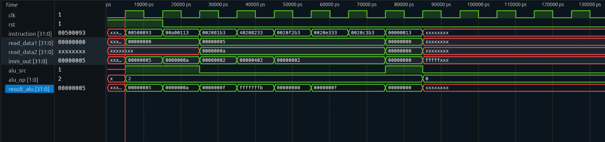
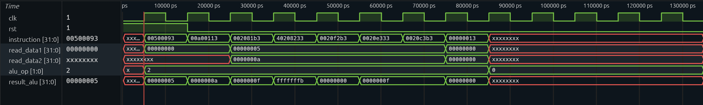
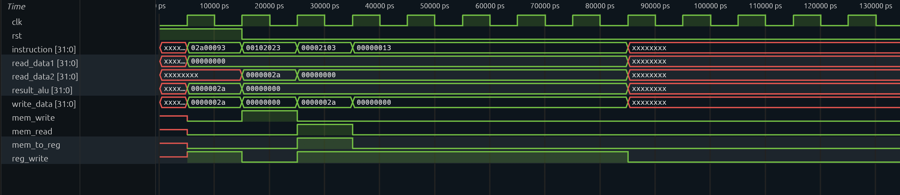
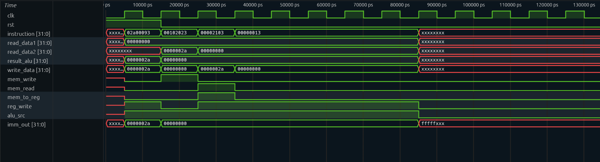
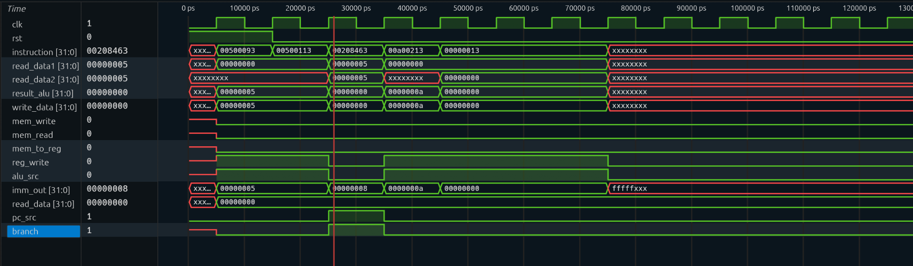
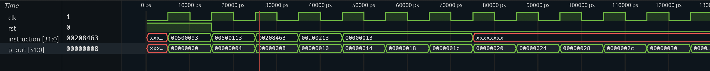

# Stage 3: Execution, Memory & Control Flow — Waveform Evidence

This folder contains waveform screenshots verifying the **Execution Stage** (`ex_stage.v`), **Memory Stage** (`mem_stage.v`), **Writeback Stage** (`wb_stage.v`), and overall single-cycle timing.

---

## 1. `06_alu_arithmetic.png`

### Short Summary
This waveform proves that the **Arithmetic Logic Unit (ALU)** accurately executes 32-bit addition (`ADD`) and subtraction (`SUB`), including negative numbers in two's complement form.

### Key Signals to Watch
- `instruction[31:0]`: Active instruction.
- `read_data1[31:0]`: Operand A ($x1 = 5$).
- `read_data2[31:0]`: Operand B ($x2 = 10$).
- `alu_src`: Selects operand B source (`0` = register, `1` = immediate).
- `result_alu[31:0]`: Output of the ALU.

### The Hardware Logic Behind It
1. **Immediate Addition (`ADDI`):**
   - For `addi x1, x0, 5`: $0 + 5 = 5 \rightarrow$ `result_alu = 00000005`.
   - For `addi x2, x0, 10`: $0 + 10 = 10 \rightarrow$ `result_alu = 0000000a`.
2. **Register Addition (`ADD x3, x1, x2`):**
   - `alu_src = 0`, inputs are $5$ and $10$.
   - `result_alu` calculates $5 + 10 = 15$ (`0000000f`).
3. **Register Subtraction (`SUB x4, x1, x2`):**
   - In instruction `40208233`, bit 30 (`funct7[5]`) is `1`.
   - `alu_control.v` selects SUB (`4'b0110`).
   - The ALU computes $5 - 10 = -5$.
   - In 32-bit two's complement hexadecimal, $-5$ is represented as `fffffffb`.
4. **Conclusion:** Both positive addition and negative subtraction produce exact mathematical results.

---

## 2. `07_alu_logical.png`

### Short Summary
This waveform proves that the **ALU** performs bitwise **AND**, **OR**, and **XOR** logical operations correctly.

### Key Signals to Watch
- `instruction[31:0]`: Active instruction.
- `read_data1[31:0]`: Value in $x1 = 5$ (`0000...0101` in binary).
- `read_data2[31:0]`: Value in $x2 = 10$ (`0000...1010` in binary).
- `result_alu[31:0]`: Bitwise logical result.

### The Hardware Logic Behind It
1. **Bitwise AND (`and x5, x1, x2` — `0020f2b3`):**
   - Binary: `0101 & 1010 = 0000`.
   - `result_alu` evaluates to `00000000`.
2. **Bitwise OR (`or x6, x1, x2` — `0020e333`):**
   - Binary: `0101 | 1010 = 1111` ($15$ in decimal).
   - `result_alu` evaluates to `0000000f`.
3. **Bitwise XOR (`xor x7, x1, x2` — `0020c3b3`):**
   - Binary: `0101 ^ 1010 = 1111` ($15$ in decimal).
   - `result_alu` evaluates to `0000000f`.
4. **Conclusion:** All bitwise Boolean circuits evaluate accurately.

---

## 3. `08_sw_lw_waveform.png` & `09_data_memory_read_verification.png`

### Short Summary
These waveforms demonstrate the full memory roundtrip: storing a value from a register into Data Memory using **Store Word (`SW`)**, and then retrieving it back into another register using **Load Word (`LW`)**.

### Key Signals to Watch
- `instruction`: `02a00093` (`addi`), `00102023` (`sw`), `00002103` (`lw`).
- `result_alu[31:0]`: Target RAM byte address calculated by the ALU.
- `read_data2[31:0]`: Data to be stored into RAM.
- `mem_write` / `mem_read`: RAM control lines.
- `write_data[31:0]`: Data selected by writeback multiplexer to store into the register file.

### The Hardware Logic Behind It
1. **Cycle 1: Load constant into register $x1$ (`addi x1, x0, 42`):**
   - Immediate value `42` (`0x2A`) is computed by the ALU and saved into register $x1$.
2. **Cycle 2: Store Word (`sw x1, 0(x0)`):**
   - Address is $x0 + 0 = 0$ (`result_alu = 0`).
   - `read_data2` carries value `42` (`0x0000002A`).
   - `mem_write = 1` and `mem_read = 0`.
   - At the clock edge, `data_mem.v` saves `0x0000002A` into memory word index `0`.
3. **Cycle 3: Load Word (`lw x2, 0(x0)`):**
   - Address is $x0 + 0 = 0$ (`result_alu = 0`).
   - `mem_read = 1` and `mem_write = 0`.
   - Asynchronously, `data_mem.v` outputs the stored `0x0000002A`.
   - The writeback multiplexer selects memory data (`mem_to_reg = 1`), sending `0x0000002A` onto `write_data`.
   - At the next clock edge, register $x2$ captures `42`.
4. **Conclusion:** Data was successfully written into RAM and read back into a new register intact.

---

## 4. `11_beq_taken_verification.png`

### Short Summary
This waveform proves that the processor correctly executes conditional branches (**`BEQ`**), changes the Program Counter, and skips instructions that should not execute.

### Key Signals to Watch
- `instruction`: Active instruction.
- `read_data1[31:0]` & `read_data2[31:0]`: Register values compared.
- `zero`: Equality flag from ALU.
- `branch`: Branch signal from Control Unit.
- `pc_src`: Next-PC multiplexer selector (`0` = sequential, `1` = branch target).
- `pc_branch`: Target address computed by branch adder.

### The Hardware Logic Behind It
1. **Setup:**
   - Previous instructions loaded $x1 = 5$ and $x2 = 5$.
2. **Branch Instruction (`beq x1, x2, +8` — `00208463`):**
   - The ALU subtracts $5 - 5 = 0$.
   - Since the result is $0$, the ALU flag **`zero` asserts HIGH (`1`)**.
   - In `branch_unit.v`, `branch == 1` and `zero == 1`, so **`pc_src` asserts HIGH (`1`)**.
   - The branch adder calculates: $\text{Current PC} + 8 = 0\text{x}08 + 8 = 0\text{x}10$.
3. **Redirection (The Jump):**
   - Because `pc_src = 1`, the next-PC multiplexer chooses `0x10` instead of sequential `0x0C`.
   - The instruction at `0x0C` (`addi x3, x0, 99`) is **completely skipped**!
   - At the next cycle, the processor executes the instruction at `0x10` (`addi x4, x0, 10`).
4. **Conclusion:** Conditional branching works and successfully redirects program flow when conditions match.

---

## 5. `performance.png`

### Short Summary
This waveform illustrates the overall timing of the single-cycle processor across consecutive clock cycles, showing steady instruction retirement without stalls.

### Key Signals to Watch
- `Time`: Timeline from 0 ps to 130000 ps (130 ns).
- `clk`: 10 ns clock period.
- `rst`: Reset signal.
- `p_out[31:0]`: Program Counter address.
- `instruction[31:0]`: Current instruction.

### The Hardware Logic Behind It
1. **Steady Single-Cycle Execution:**
   - From reset release ($t = 15\,\text{ns}$) to the end of simulation, exactly **one instruction begins and finishes every 10 ns**.
   - Cycle 1 (15–25 ns): `addi x1, x0, 5` completes.
   - Cycle 2 (25–35 ns): `addi x2, x0, 5` completes.
   - Cycle 3 (35–45 ns): `beq x1, x2, +8` evaluates equality and redirects PC.
   - Cycle 4 (45–55 ns): `addi x4, x0, 10` executes at branch target address `0x10`.
   - Subsequent cycles: NOP instructions complete at 1 cycle each.
2. **Conclusion:** This confirms an ideal single-cycle execution metric of **Cycles Per Instruction (CPI) = 1.0**.
